# Day 16 - 日期时间(Date Time)

```mermaid
%%{init: {'flowchart': {'curve': 'basis', 'nodeSpacing': 8, 'rankSpacing': 40}}}%%
flowchart LR
  R(["Day 16 日期时间"])
  R --- b0["datetime 模块"]
  b0 --- n1["四个常用的类"]
  subgraph sn1[" "]
  n1 --- n2["date 日期"]
  n1 --- n3["datetime 日期加时间"]
  n1 --- n4["time 一天里的时刻"]
  n1 --- n5["timedelta 一段时间"]
  end
  style sn1 fill:none,stroke:none
  b0 --- n6["dir(datetime)"]
  n6 --- n7["列出模块里有什么"]
  classDef c0 fill:none,stroke:#F5A623,stroke-width:2px,color:#F5A623,font-weight:bold
  class b0 c0
  R --- b1["获取当前时间"]
  b1 --- n8["datetime.now()"]
  subgraph sn8[" "]
  n8 --- n9["现在这一刻"]
  n8 --- n10["每次调用结果不同"]
  end
  style sn8 fill:none,stroke:none
  b1 --- n11["读各个部分"]
  subgraph sn11[" "]
  n11 --- n12["year month day"]
  n11 --- n13["hour minute second"]
  end
  style sn11 fill:none,stroke:none
  b1 --- n14["now.timestamp()"]
  subgraph sn14[" "]
  n14 --- n15["1970-01-01 以来的秒数"]
  n14 --- n16["是一个浮点数"]
  end
  style sn14 fill:none,stroke:none
  classDef c1 fill:none,stroke:#4A90E2,stroke-width:2px,color:#4A90E2,font-weight:bold
  class b1 c1
  R --- b2["自己指定时间"]
  b2 --- n17["datetime(2020, 1, 1)"]
  subgraph sn17[" "]
  n17 --- n18["没写的部分默认是 0"]
  n17 --- n19["2020-01-01 00:00:00"]
  end
  style sn17 fill:none,stroke:none
  classDef c2 fill:none,stroke:#2ECC71,stroke-width:2px,color:#2ECC71,font-weight:bold
  class b2 c2
  R --- b3["strftime"]
  b3 --- n20["时间 → 字符串"]
  n20 --- n21["f = format 格式化"]
  b3 --- n22["格式代码"]
  subgraph sn22[" "]
  n22 --- n23["%Y %m %d 年月日"]
  n22 --- n24["%H %M %S 时分秒"]
  n22 --- n25["%B 月份英文全称"]
  end
  style sn22 fill:none,stroke:none
  b3 --- n26["改顺序就改格式"]
  subgraph sn26[" "]
  n26 --- n27["%m/%d/%Y 美式"]
  n26 --- n28["%d/%m/%Y 日在前"]
  end
  style sn26 fill:none,stroke:none
  classDef c3 fill:none,stroke:#A66CFF,stroke-width:2px,color:#A66CFF,font-weight:bold
  class b3 c3
  R --- b4["strptime"]
  b4 --- n29["字符串 → 时间"]
  n29 --- n30["p = parse 解析"]
  b4 --- n31["格式要和字符串一一对应"]
  n31 --- n32["对不上报 ValueError"]
  b4 --- n33["'5 December, 2019'"]
  n33 --- n34["%d %B, %Y"]
  classDef c4 fill:none,stroke:#FF6B6B,stroke-width:2px,color:#FF6B6B,font-weight:bold
  class b4 c4
  R --- b5["date 和 time"]
  b5 --- n35["date(2020, 1, 1)"]
  n35 --- n36["只有年月日"]
  b5 --- n37["date.today()"]
  n37 --- n38["今天的日期"]
  b5 --- n39["time(10, 30, 50)"]
  subgraph sn39[" "]
  n39 --- n40["只有时分秒"]
  n39 --- n41["可以加微秒"]
  end
  style sn39 fill:none,stroke:none
  classDef c5 fill:none,stroke:#1ABC9C,stroke-width:2px,color:#1ABC9C,font-weight:bold
  class b5 c5
  R --- b6["时间差"]
  b6 --- n42["两个时间相减"]
  subgraph sn42[" "]
  n42 --- n43["得到 timedelta"]
  n42 --- n44["date 减 date"]
  n42 --- n45["datetime 减 datetime"]
  end
  style sn42 fill:none,stroke:none
  b6 --- n46["date 和 datetime 不能混着减"]
  n46 --- n47["TypeError"]
  classDef c6 fill:none,stroke:#F06292,stroke-width:2px,color:#F06292,font-weight:bold
  class b6 c6
  R --- b7["timedelta"]
  b7 --- n48["timedelta(weeks, days, hours...)"]
  n48 --- n49["表示一段时间"]
  b7 --- n50["可以加减"]
  subgraph sn50[" "]
  n50 --- n51["加到日期上得到新日期"]
  n50 --- n52["两个 timedelta 相减"]
  end
  style sn50 fill:none,stroke:none
  b7 --- n53["读结果"]
  subgraph sn53[" "]
  n53 --- n54["td.days"]
  n53 --- n55["td.seconds 不是总秒数"]
  n53 --- n56["td.total_seconds()"]
  end
  style sn53 fill:none,stroke:none
  classDef c7 fill:none,stroke:#FFC107,stroke-width:2px,color:#FFC107,font-weight:bold
  class b7 c7
  R --- b8["容易出错的地方"]
  b8 --- n57["大小写格式代码"]
  subgraph sn57[" "]
  n57 --- n58["%m 月 %M 分"]
  n57 --- n59["%y 两位年 %Y 四位年"]
  end
  style sn57 fill:none,stroke:none
  b8 --- n60["f 字符串不补零"]
  n60 --- n61["0:5 不是 00:05"]
  b8 --- n62["strptime 格式要完全一致"]
  classDef c8 fill:none,stroke:#26C6DA,stroke-width:2px,color:#26C6DA,font-weight:bold
  class b8 c8
  classDef leaf fill:none,stroke:none,color:#9AA0A6
  classDef root fill:#5B5FC7,stroke:none,color:#fff,font-weight:bold
  class R root
  class n1,n2,n3,n4,n5,n6,n7,n8,n9,n10,n11,n12,n13,n14,n15,n16,n17,n18,n19,n20,n21,n22,n23,n24,n25,n26,n27,n28,n29,n30,n31,n32,n33,n34,n35,n36,n37,n38,n39,n40,n41,n42,n43,n44,n45,n46,n47,n48,n49,n50,n51,n52,n53,n54,n55,n56,n57,n58,n59,n60,n61,n62 leaf
  linkStyle 0 stroke:#F5A623,stroke-width:1.5px
  linkStyle 1 stroke:#F5A623,stroke-width:1.5px
  linkStyle 2 stroke:#F5A623,stroke-width:1.5px
  linkStyle 3 stroke:#F5A623,stroke-width:1.5px
  linkStyle 4 stroke:#F5A623,stroke-width:1.5px
  linkStyle 5 stroke:#F5A623,stroke-width:1.5px
  linkStyle 6 stroke:#F5A623,stroke-width:1.5px
  linkStyle 7 stroke:#F5A623,stroke-width:1.5px
  linkStyle 8 stroke:#4A90E2,stroke-width:1.5px
  linkStyle 9 stroke:#4A90E2,stroke-width:1.5px
  linkStyle 10 stroke:#4A90E2,stroke-width:1.5px
  linkStyle 11 stroke:#4A90E2,stroke-width:1.5px
  linkStyle 12 stroke:#4A90E2,stroke-width:1.5px
  linkStyle 13 stroke:#4A90E2,stroke-width:1.5px
  linkStyle 14 stroke:#4A90E2,stroke-width:1.5px
  linkStyle 15 stroke:#4A90E2,stroke-width:1.5px
  linkStyle 16 stroke:#4A90E2,stroke-width:1.5px
  linkStyle 17 stroke:#4A90E2,stroke-width:1.5px
  linkStyle 18 stroke:#2ECC71,stroke-width:1.5px
  linkStyle 19 stroke:#2ECC71,stroke-width:1.5px
  linkStyle 20 stroke:#2ECC71,stroke-width:1.5px
  linkStyle 21 stroke:#2ECC71,stroke-width:1.5px
  linkStyle 22 stroke:#A66CFF,stroke-width:1.5px
  linkStyle 23 stroke:#A66CFF,stroke-width:1.5px
  linkStyle 24 stroke:#A66CFF,stroke-width:1.5px
  linkStyle 25 stroke:#A66CFF,stroke-width:1.5px
  linkStyle 26 stroke:#A66CFF,stroke-width:1.5px
  linkStyle 27 stroke:#A66CFF,stroke-width:1.5px
  linkStyle 28 stroke:#A66CFF,stroke-width:1.5px
  linkStyle 29 stroke:#A66CFF,stroke-width:1.5px
  linkStyle 30 stroke:#A66CFF,stroke-width:1.5px
  linkStyle 31 stroke:#A66CFF,stroke-width:1.5px
  linkStyle 32 stroke:#FF6B6B,stroke-width:1.5px
  linkStyle 33 stroke:#FF6B6B,stroke-width:1.5px
  linkStyle 34 stroke:#FF6B6B,stroke-width:1.5px
  linkStyle 35 stroke:#FF6B6B,stroke-width:1.5px
  linkStyle 36 stroke:#FF6B6B,stroke-width:1.5px
  linkStyle 37 stroke:#FF6B6B,stroke-width:1.5px
  linkStyle 38 stroke:#FF6B6B,stroke-width:1.5px
  linkStyle 39 stroke:#1ABC9C,stroke-width:1.5px
  linkStyle 40 stroke:#1ABC9C,stroke-width:1.5px
  linkStyle 41 stroke:#1ABC9C,stroke-width:1.5px
  linkStyle 42 stroke:#1ABC9C,stroke-width:1.5px
  linkStyle 43 stroke:#1ABC9C,stroke-width:1.5px
  linkStyle 44 stroke:#1ABC9C,stroke-width:1.5px
  linkStyle 45 stroke:#1ABC9C,stroke-width:1.5px
  linkStyle 46 stroke:#1ABC9C,stroke-width:1.5px
  linkStyle 47 stroke:#F06292,stroke-width:1.5px
  linkStyle 48 stroke:#F06292,stroke-width:1.5px
  linkStyle 49 stroke:#F06292,stroke-width:1.5px
  linkStyle 50 stroke:#F06292,stroke-width:1.5px
  linkStyle 51 stroke:#F06292,stroke-width:1.5px
  linkStyle 52 stroke:#F06292,stroke-width:1.5px
  linkStyle 53 stroke:#F06292,stroke-width:1.5px
  linkStyle 54 stroke:#FFC107,stroke-width:1.5px
  linkStyle 55 stroke:#FFC107,stroke-width:1.5px
  linkStyle 56 stroke:#FFC107,stroke-width:1.5px
  linkStyle 57 stroke:#FFC107,stroke-width:1.5px
  linkStyle 58 stroke:#FFC107,stroke-width:1.5px
  linkStyle 59 stroke:#FFC107,stroke-width:1.5px
  linkStyle 60 stroke:#FFC107,stroke-width:1.5px
  linkStyle 61 stroke:#FFC107,stroke-width:1.5px
  linkStyle 62 stroke:#FFC107,stroke-width:1.5px
  linkStyle 63 stroke:#FFC107,stroke-width:1.5px
  linkStyle 64 stroke:#26C6DA,stroke-width:1.5px
  linkStyle 65 stroke:#26C6DA,stroke-width:1.5px
  linkStyle 66 stroke:#26C6DA,stroke-width:1.5px
  linkStyle 67 stroke:#26C6DA,stroke-width:1.5px
  linkStyle 68 stroke:#26C6DA,stroke-width:1.5px
  linkStyle 69 stroke:#26C6DA,stroke-width:1.5px
  linkStyle 70 stroke:#26C6DA,stroke-width:1.5px
```



---

## 补充说明

### 1. datetime 模块
```python
import datetime
print(dir(datetime))
```
- `dir()` 能列出一个模块里有什么;`datetime` 模块里这一天用到四个类:

| 类 | 表示什么 | 例子 |
|---|---|---|
| `date` | 日期(年月日) | `2020-01-01` |
| `datetime` | 日期加时间 | `2020-01-01 08:30:00` |
| `time` | 一天里的时刻(时分秒) | `10:30:50` |
| `timedelta` | 一**段**时间 | `27 days, 0:00:00` |

- 注意:模块和类**同名**,所以常写成 `from datetime import datetime`,之后直接用 `datetime.now()`;如果写成 `import datetime`,就要写 `datetime.datetime.now()`

### 2. 获取当前时间
```python
from datetime import datetime
now = datetime.now()
print(now)                      # 2021-07-08 07:34:46.549883
day = now.day                   # 8
month = now.month               # 7
year = now.year                 # 2021
hour = now.hour                 # 7
minute = now.minute             # 38
second = now.second
timestamp = now.timestamp()
print(day, month, year, hour, minute)
print('timestamp', timestamp)
print(f'{day}/{month}/{year}, {hour}:{minute}')  # 8/7/2021, 7:38
```
- `datetime.now()` 是**运行代码的这一刻**,所以每次运行结果都不一样(上面的注释只是教程运行时的结果)
- `.year .month .day .hour .minute .second` 分别取出各个部分,都是整数
- `now.timestamp()` 是**时间戳**:从 1970 年 1 月 1 日 0 点(UTC)到现在经过的**秒数**,是一个浮点数,约 `1.79e9`,单位是秒不是毫秒
- 时间戳常用来记录"某件事发生在什么时候",因为一个数字好存、好比大小

### 3. 自己指定时间
```python
from datetime import datetime
new_year = datetime(2020, 1, 1)
print(new_year)      # 2020-01-01 00:00:00
print(new_year.day, new_year.month, new_year.year, new_year.hour, new_year.minute)
# 1 1 2020 0 0
```
- 括号里依次是 年、月、日(必须写),再往后是 时、分、秒(可以不写)
- 没写的部分默认是 `0`,所以是 `00:00:00`

### 4. strftime:时间 → 字符串
```python
from datetime import datetime
now = datetime.now()
t = now.strftime("%H:%M:%S")
time_one = now.strftime("%m/%d/%Y, %H:%M:%S")   # 月/日/年
time_two = now.strftime("%d/%m/%Y, %H:%M:%S")   # 日/月/年
```
假设现在是 2019 年 12 月 5 日 01:05:01,输出是:
```
time: 01:05:01
time one: 12/05/2019, 01:05:01
time two: 05/12/2019, 01:05:01
```
- `strftime` 的 **f 是 format(格式化)**:把时间对象按你写的格式变成字符串
- 格式里的 `%X` 是占位符,不是 `%` 的字符原样保留(比如 `/`、`:`、`,`)
- 想换顺序、换分隔符,只要改格式字符串

常用格式代码(教程里是一张图片,这里列出常用的,都在 Python 里跑过,以 2019-12-05 01:05:01 为例):

| 代码 | 意思 | 结果 |
|---|---|---|
| `%Y` | 四位年 | `2019` |
| `%y` | 两位年 | `19` |
| `%m` | 月(两位数) | `12` |
| `%B` | 月份英文全称 | `December` |
| `%b` | 月份英文缩写 | `Dec` |
| `%d` | 日(两位数) | `05` |
| `%A` | 星期英文全称 | `Thursday` |
| `%a` | 星期英文缩写 | `Thu` |
| `%H` | 小时(24 小时制) | `01` |
| `%I` | 小时(12 小时制) | `01` |
| `%p` | 上午或下午 | `AM` |
| `%M` | 分钟 | `05` |
| `%S` | 秒 | `01` |
| `%f` | 微秒 | `000000` |

### 5. strptime:字符串 → 时间
```python
from datetime import datetime
date_string = "5 December, 2019"
date_object = datetime.strptime(date_string, "%d %B, %Y")
print("date_object =", date_object)     # 2019-12-05 00:00:00
```
- `strptime` 的 **p 是 parse(解析)**:和 `strftime` 方向相反,把字符串变成时间对象
- 需要两个参数:**要解析的字符串**,和**描述这个字符串长什么样的格式**
- 格式要和字符串**一一对应**:`"5 December, 2019"` 是 日 + 空格 + 月份全称 + 逗号 + 空格 + 年,所以格式是 `"%d %B, %Y"`;空格和逗号也要写
- 对不上就报 `ValueError: time data '5 December, 2019' does not match format '%d/%m/%Y'`
- 记法:**strftime 是 f(格式化)出来变字符串,strptime 是 p(解析)进来变时间对象**

### 6. date 和 time
**date:只有年月日**
```python
from datetime import date
d = date(2020, 1, 1)
print(d)                            # 2020-01-01
print('Current date:', d.today())   # 今天的日期
today = date.today()
print(today.year, today.month, today.day)
```
- `date.today()` 得到今天的日期;教程里写的 `d.today()` 效果一样,和 `d` 是哪一天没关系,所以我们写 `date.today()` 就行

**time:只有时分秒**
```python
from datetime import time
a = time()                              # 00:00:00
b = time(10, 30, 50)                    # 10:30:50
c = time(hour=10, minute=30, second=50) # 10:30:50
d = time(10, 30, 50, 200555)            # 10:30:50.200555
```
- 不写就是 `00:00:00`;第 4 个参数是**微秒**
- 可以按位置写,也可以写成 `hour=10` 这样的关键字参数(Day 11 学过)

### 7. 时间差
```python
from datetime import date, datetime
today = date(year=2019, month=12, day=5)
new_year = date(year=2020, month=1, day=1)
time_left_for_newyear = new_year - today
print('Time left for new year: ', time_left_for_newyear)   # 27 days, 0:00:00

t1 = datetime(year=2019, month=12, day=5, hour=0, minute=59, second=0)
t2 = datetime(year=2020, month=1, day=1, hour=0, minute=0, second=0)
diff = t2 - t1
print('Time left for new year:', diff)   # 26 days, 23:01:00
```
- 两个 `date` 相减、或两个 `datetime` 相减,得到的是 **`timedelta`**(一段时间),不是日期
- 用 `date` 只算到天,所以是 `27 days, 0:00:00`;用 `datetime` 加上时间,多出的 59 分钟让差少了一点,是 `26 days, 23:01:00`
- **`date` 和 `datetime` 不能混着减**,会报 `TypeError: unsupported operand type(s)`,要两边是同一种类型

### 8. timedelta
```python
from datetime import timedelta
t1 = timedelta(weeks=12, days=10, hours=4, seconds=20)
t2 = timedelta(days=7, hours=5, minutes=3, seconds=30)
t3 = t1 - t2
print("t3 =", t3)      # t3 = 86 days, 22:56:50
```
- `timedelta` 表示**一段时间**,可以用 weeks、days、hours、minutes、seconds 等来创建,不写的就是 0
- `t1` = 12 周 + 10 天 + 4 小时 + 20 秒 = 94 天 4:00:20;`t2` = 7 天 5:03:30;相减是 `86 days, 22:56:50`
- 教程这段的输出里混进了上一段的两行(`date_string`、`date_object`),那是复制粘贴的残留,真正的输出只有 `t3 = ...` 这一行
- timedelta 还能加到日期上得到新日期:`datetime(2019, 12, 5) + timedelta(days=30)` 得到 `2020-01-04 00:00:00`
- 读结果时要注意:`td.days` 是整数天数,`td.seconds` 是**不满一天的那部分秒数**(不是总秒数),要总共多少秒用 `td.total_seconds()`

| 上面的 `diff`(`26 days, 23:01:00`) | 值 |
|---|---|
| `diff.days` | `26` |
| `diff.seconds` | `82860`(23 小时 1 分的秒数) |
| `diff.total_seconds()` | `2329260.0`(总共多少秒) |

### 9. 练习
教程的 5 道题(第 6 题只是让你想想有什么用):
```python
from datetime import datetime

# 1. 当前的日、月、年、时、分和时间戳
now = datetime.now()
print(now.day, now.month, now.year, now.hour, now.minute, now.timestamp())

# 2. 按 "%m/%d/%Y, %H:%M:%S" 格式化当前时间
print(now.strftime("%m/%d/%Y, %H:%M:%S"))

# 3. 把 "5 December, 2019" 变成时间对象
print(datetime.strptime("5 December, 2019", "%d %B, %Y"))

# 4. 现在到下一个新年还有多久
new_year = datetime(now.year + 1, 1, 1)
print(new_year - now)

# 5. 1970 年 1 月 1 日到现在过了多久
print(now - datetime(1970, 1, 1))
```
- 第 4 题要用 `now.year + 1`,新年是**下一年**的 1 月 1 日,不是今年的
- 第 5 题的结果换成秒,就和时间戳(第 1 题)差不多:`(now - datetime(1970, 1, 1)).total_seconds()`
- 第 6 题:`datetime` 能用来做**时间序列分析**、给程序里的各种操作**记录时间**、给博客文章**标日期**

### 10. 容易出错的地方
1. **大小写不同,意思不同**:`%m` 是月,`%M` 是分;`%y` 是两位年,`%Y` 是四位年;`%b` 是缩写月份,`%B` 是全称;`%a` / `%A` 同理;`%H` 是 24 小时制,`%I` 是 12 小时制
2. **f 字符串不补零**:`f'{hour}:{minute}'` 在 0 点 5 分时得到 `0:5`;`strftime("%H:%M")` 才是 `00:05`
3. **`strptime` 的格式要和字符串完全对应**,包括空格、逗号、斜杠,差一个字符就 `ValueError`
4. **`strftime` 和 `strptime` 别搞混**:f 是格式化(时间 → 字符串),p 是解析(字符串 → 时间)
5. **`date` 和 `datetime` 不能互相相减**,会 `TypeError`
6. **`td.seconds` 不是总秒数**,总秒数用 `td.total_seconds()`
7. **时间戳单位是秒**,不是毫秒
8. **`import datetime` 和 `from datetime import datetime` 写法不同**:前者要写 `datetime.datetime.now()`
9. 教程的注释里的时间(2019、2021 等)只是它运行时的结果,你运行得到的是你当下的时间


---

[📚 目录](README.md) · [下一天：Day 17 异常处理 ➡️](Day17_异常处理.md)
