# Day 17 - 异常处理(Exception Handling)

```mermaid
%%{init: {'flowchart': {'curve': 'basis', 'nodeSpacing': 8, 'rankSpacing': 40}}}%%
flowchart LR
  R(["Day 17 异常处理"])
  R --- b0["try / except"]
  b0 --- n1["try 里放可能出错的代码"]
  b0 --- n2["except 里放出错后做的事"]
  subgraph sn2[" "]
  n2 --- n3["出错时立刻跳进 except"]
  n2 --- n4["程序不会崩溃"]
  end
  style sn2 fill:none,stroke:none
  b0 --- n5["裸 except"]
  subgraph sn5[" "]
  n5 --- n6["只知道出错了"]
  n5 --- n7["不知道出了什么错"]
  end
  style sn5 fill:none,stroke:none
  classDef c0 fill:none,stroke:#F5A623,stroke-width:2px,color:#F5A623,font-weight:bold
  class b0 c0
  R --- b1["指定错误类型"]
  b1 --- n8["TypeError"]
  subgraph sn8[" "]
  n8 --- n9["类型不对"]
  n8 --- n10["2019 - '1920'"]
  end
  style sn8 fill:none,stroke:none
  b1 --- n11["ValueError"]
  subgraph sn11[" "]
  n11 --- n12["值不对"]
  n11 --- n13["int('abc')"]
  end
  style sn11 fill:none,stroke:none
  b1 --- n14["ZeroDivisionError"]
  n14 --- n15["除以 0"]
  b1 --- n16["从上往下匹配"]
  subgraph sn16[" "]
  n16 --- n17["第一个匹配的就停"]
  n16 --- n18["具体的写前面，笼统的写后面"]
  end
  style sn16 fill:none,stroke:none
  classDef c1 fill:none,stroke:#4A90E2,stroke-width:2px,color:#4A90E2,font-weight:bold
  class b1 c1
  R --- b2["else 和 finally"]
  b2 --- n19["else"]
  n19 --- n20["没出错才执行"]
  b2 --- n21["finally"]
  n21 --- n22["不管出不出错都执行"]
  b2 --- n23["执行顺序"]
  subgraph sn23[" "]
  n23 --- n24["没出错：try → else → finally"]
  n23 --- n25["出错：try → except → finally"]
  end
  style sn23 fill:none,stroke:none
  classDef c2 fill:none,stroke:#2ECC71,stroke-width:2px,color:#2ECC71,font-weight:bold
  class b2 c2
  R --- b3["except Exception as e"]
  b3 --- n26["Exception 是大多数错误的父类"]
  b3 --- n27["e 是错误对象"]
  n27 --- n28["print(e) 看具体信息"]
  classDef c3 fill:none,stroke:#A66CFF,stroke-width:2px,color:#A66CFF,font-weight:bold
  class b3 c3
  R --- b4["解包 Unpacking"]
  b4 --- n29["*列表"]
  subgraph sn29[" "]
  n29 --- n30["拆成多个位置参数"]
  n29 --- n31["f(*lst)"]
  end
  style sn29 fill:none,stroke:none
  b4 --- n32["**字典"]
  subgraph sn32[" "]
  n32 --- n33["拆成关键字参数"]
  n32 --- n34["键名要和参数名一致"]
  end
  style sn32 fill:none,stroke:none
  b4 --- n35["拆给变量"]
  subgraph sn35[" "]
  n35 --- n36["fin, sw, nor, *rest = countries"]
  n35 --- n37["带 * 的变量得到列表"]
  end
  style sn35 fill:none,stroke:none
  classDef c4 fill:none,stroke:#FF6B6B,stroke-width:2px,color:#FF6B6B,font-weight:bold
  class b4 c4
  R --- b5["打包 Packing"]
  b5 --- n38["*args"]
  subgraph sn38[" "]
  n38 --- n39["收集多余的位置参数"]
  n38 --- n40["得到元组"]
  end
  style sn38 fill:none,stroke:none
  b5 --- n41["**kwargs"]
  subgraph sn41[" "]
  n41 --- n42["收集多余的关键字参数"]
  n41 --- n43["得到字典"]
  end
  style sn41 fill:none,stroke:none
  b5 --- n44["调用时拆开，定义时收集"]
  classDef c5 fill:none,stroke:#1ABC9C,stroke-width:2px,color:#1ABC9C,font-weight:bold
  class b5 c5
  R --- b6["展开 Spreading"]
  b6 --- n45["[0, *a, *b]"]
  n45 --- n46["把几个列表合成一个新列表"]
  classDef c6 fill:none,stroke:#F06292,stroke-width:2px,color:#F06292,font-weight:bold
  class b6 c6
  R --- b7["enumerate 和 zip"]
  b7 --- n47["enumerate"]
  subgraph sn47[" "]
  n47 --- n48["同时拿到索引和元素"]
  n47 --- n49["索引默认从 0 开始"]
  end
  style sn47 fill:none,stroke:none
  b7 --- n50["zip"]
  subgraph sn50[" "]
  n50 --- n51["并排遍历多个列表"]
  n50 --- n52["按最短的那个停"]
  end
  style sn50 fill:none,stroke:none
  classDef c7 fill:none,stroke:#FFC107,stroke-width:2px,color:#FFC107,font-weight:bold
  class b7 c7
  R --- b8["容易出错的地方"]
  b8 --- n53["input() 返回字符串"]
  n53 --- n54["要 int() 转换"]
  b8 --- n55["except 顺序"]
  b8 --- n56["裸 except 会藏住问题"]
  b8 --- n57["print(range(...)) 不是列表"]
  classDef c8 fill:none,stroke:#26C6DA,stroke-width:2px,color:#26C6DA,font-weight:bold
  class b8 c8
  classDef leaf fill:none,stroke:none,color:#9AA0A6
  classDef root fill:#5B5FC7,stroke:none,color:#fff,font-weight:bold
  class R root
  class n1,n2,n3,n4,n5,n6,n7,n8,n9,n10,n11,n12,n13,n14,n15,n16,n17,n18,n19,n20,n21,n22,n23,n24,n25,n26,n27,n28,n29,n30,n31,n32,n33,n34,n35,n36,n37,n38,n39,n40,n41,n42,n43,n44,n45,n46,n47,n48,n49,n50,n51,n52,n53,n54,n55,n56,n57 leaf
  linkStyle 0 stroke:#F5A623,stroke-width:1.5px
  linkStyle 1 stroke:#F5A623,stroke-width:1.5px
  linkStyle 2 stroke:#F5A623,stroke-width:1.5px
  linkStyle 3 stroke:#F5A623,stroke-width:1.5px
  linkStyle 4 stroke:#F5A623,stroke-width:1.5px
  linkStyle 5 stroke:#F5A623,stroke-width:1.5px
  linkStyle 6 stroke:#F5A623,stroke-width:1.5px
  linkStyle 7 stroke:#F5A623,stroke-width:1.5px
  linkStyle 8 stroke:#4A90E2,stroke-width:1.5px
  linkStyle 9 stroke:#4A90E2,stroke-width:1.5px
  linkStyle 10 stroke:#4A90E2,stroke-width:1.5px
  linkStyle 11 stroke:#4A90E2,stroke-width:1.5px
  linkStyle 12 stroke:#4A90E2,stroke-width:1.5px
  linkStyle 13 stroke:#4A90E2,stroke-width:1.5px
  linkStyle 14 stroke:#4A90E2,stroke-width:1.5px
  linkStyle 15 stroke:#4A90E2,stroke-width:1.5px
  linkStyle 16 stroke:#4A90E2,stroke-width:1.5px
  linkStyle 17 stroke:#4A90E2,stroke-width:1.5px
  linkStyle 18 stroke:#4A90E2,stroke-width:1.5px
  linkStyle 19 stroke:#4A90E2,stroke-width:1.5px
  linkStyle 20 stroke:#2ECC71,stroke-width:1.5px
  linkStyle 21 stroke:#2ECC71,stroke-width:1.5px
  linkStyle 22 stroke:#2ECC71,stroke-width:1.5px
  linkStyle 23 stroke:#2ECC71,stroke-width:1.5px
  linkStyle 24 stroke:#2ECC71,stroke-width:1.5px
  linkStyle 25 stroke:#2ECC71,stroke-width:1.5px
  linkStyle 26 stroke:#2ECC71,stroke-width:1.5px
  linkStyle 27 stroke:#2ECC71,stroke-width:1.5px
  linkStyle 28 stroke:#A66CFF,stroke-width:1.5px
  linkStyle 29 stroke:#A66CFF,stroke-width:1.5px
  linkStyle 30 stroke:#A66CFF,stroke-width:1.5px
  linkStyle 31 stroke:#A66CFF,stroke-width:1.5px
  linkStyle 32 stroke:#FF6B6B,stroke-width:1.5px
  linkStyle 33 stroke:#FF6B6B,stroke-width:1.5px
  linkStyle 34 stroke:#FF6B6B,stroke-width:1.5px
  linkStyle 35 stroke:#FF6B6B,stroke-width:1.5px
  linkStyle 36 stroke:#FF6B6B,stroke-width:1.5px
  linkStyle 37 stroke:#FF6B6B,stroke-width:1.5px
  linkStyle 38 stroke:#FF6B6B,stroke-width:1.5px
  linkStyle 39 stroke:#FF6B6B,stroke-width:1.5px
  linkStyle 40 stroke:#FF6B6B,stroke-width:1.5px
  linkStyle 41 stroke:#FF6B6B,stroke-width:1.5px
  linkStyle 42 stroke:#1ABC9C,stroke-width:1.5px
  linkStyle 43 stroke:#1ABC9C,stroke-width:1.5px
  linkStyle 44 stroke:#1ABC9C,stroke-width:1.5px
  linkStyle 45 stroke:#1ABC9C,stroke-width:1.5px
  linkStyle 46 stroke:#1ABC9C,stroke-width:1.5px
  linkStyle 47 stroke:#1ABC9C,stroke-width:1.5px
  linkStyle 48 stroke:#1ABC9C,stroke-width:1.5px
  linkStyle 49 stroke:#1ABC9C,stroke-width:1.5px
  linkStyle 50 stroke:#F06292,stroke-width:1.5px
  linkStyle 51 stroke:#F06292,stroke-width:1.5px
  linkStyle 52 stroke:#F06292,stroke-width:1.5px
  linkStyle 53 stroke:#FFC107,stroke-width:1.5px
  linkStyle 54 stroke:#FFC107,stroke-width:1.5px
  linkStyle 55 stroke:#FFC107,stroke-width:1.5px
  linkStyle 56 stroke:#FFC107,stroke-width:1.5px
  linkStyle 57 stroke:#FFC107,stroke-width:1.5px
  linkStyle 58 stroke:#FFC107,stroke-width:1.5px
  linkStyle 59 stroke:#FFC107,stroke-width:1.5px
  linkStyle 60 stroke:#26C6DA,stroke-width:1.5px
  linkStyle 61 stroke:#26C6DA,stroke-width:1.5px
  linkStyle 62 stroke:#26C6DA,stroke-width:1.5px
  linkStyle 63 stroke:#26C6DA,stroke-width:1.5px
  linkStyle 64 stroke:#26C6DA,stroke-width:1.5px
  linkStyle 65 stroke:#26C6DA,stroke-width:1.5px
```



---

## 补充说明

### 1. try / except:出错了也不崩溃
```python
try:
    print(10 + '5')
except:
    print('Something went wrong')
```
- 出错的原因常常在程序外面:用户输入不对、文件名写错、设备出故障
- `try` 里放**可能出错的代码**,`except` 里放**出错以后要做的事**
- `try` 里一旦出错,**立刻跳进 `except`**,`try` 里剩下的代码不再执行;程序不会崩溃,打印完提示还能往下走
- 不写 `try/except`,出错就是直接报错退出
- 上面的例子里 `10 + '5'` 是数字加字符串,所以进了 `except`

### 2. 指定错误类型
只写 `except:` 的问题:只知道出错了,**不知道出了什么错**。写上错误类型就能分开处理:
```python
try:
    name = input('Enter your name:')
    year_born = input('Year you were born:')
    age = 2019 - year_born
    print(f'You are {name}. And your age is {age}.')
except TypeError:
    print('Type error occured')
except ValueError:
    print('Value error occured')
except ZeroDivisionError:
    print('zero division error occured')
```
| 错误 | 意思 | 例子 |
|---|---|---|
| `TypeError` | 类型不对 | `2019 - '1920'`、`10 + '5'` |
| `ValueError` | 类型对,但值不合适 | `int('abc')` |
| `ZeroDivisionError` | 除以 0 | `1 / 0` |

- 上面的代码输入 `1920` 会进 `TypeError`:`input()` 得到的是**字符串**,字符串不能被数字减
- 多个 `except` 是**从上往下**匹配,第一个匹配的执行完就结束,后面的不再看

### 3. else 和 finally
```python
try:
    name = input('Enter your name:')
    year_born = input('Year you born:')
    age = 2019 - int(year_born)
    print(f'You are {name}. And your age is {age}.')
except TypeError:
    print('Type error occur')
except ValueError:
    print('Value error occur')
except ZeroDivisionError:
    print('zero division error occur')
else:
    print('I usually run with the try block')
finally:
    print('I alway run.')
```
- `else`:**没出错**才执行
- `finally`:**不管出不出错都执行**(常用来做收尾工作,比如关闭文件)
- 这次加了 `int(year_born)`,输入 `1920` 就不再报错:

| 情况 | 执行顺序 |
|---|---|
| 没出错 | `try` → `else` → `finally` |
| 出错 | `try`(到出错那一行为止)→ 对应的 `except` → `finally` |

- 输入 `1920` 的输出:`You are Asabeneh. And your age is 99.`、`I usually run with the try block`、`I alway run.`
- 输入 `abc` 会在 `int('abc')` 那里出 `ValueError`,执行 `except ValueError` 和 `finally`,**不会**执行 `else`

### 4. except Exception as e
```python
try:
    ...
except Exception as e:
    print(e)
```
- `Exception` 是大多数错误的**共同父类**,写它就能接住几乎所有错误,不用一个个列出来
- `as e`:把错误对象起名叫 `e`,`print(e)` 能看到具体的错误信息,比如 `unsupported operand type(s) for -: 'int' and 'str'`
- 它比裸 `except:` 好:裸 `except:` 连 `Ctrl+C` 中断都会接住,`except Exception` 不会
- 但它也会把你自己代码里的 bug 一起藏起来,所以能写具体类型的时候,先写具体类型

### 5. 解包 Unpacking(`*` 和 `**`)
**`*` 用在列表、元组、range 前面,拆成多个位置参数:**
```python
def sum_of_five_nums(a, b, c, d, e):
    return a + b + c + d + e

lst = [1, 2, 3, 4, 5]
print(sum_of_five_nums(lst))    # TypeError: 只给了 1 个参数,缺 4 个
print(sum_of_five_nums(*lst))   # 15
```
`range` 要两个参数(开始和结束),也可以从列表里拆:
```python
args = [2, 7]
numbers = range(*args)          # 等于 range(2, 7)
print(list(numbers))            # [2, 3, 4, 5, 6]
```
- 教程里 `print(numbers)` 后面的注释写的是 `[2, 3, 4, 5,6]`,其实 `print(numbers)` 打印的是 `range(2, 7)`,要用 `list()` 才能看到列表

**拆给变量,带 `*` 的变量接收"剩下的":**
```python
countries = ['Finland', 'Sweden', 'Norway', 'Denmark', 'Iceland']
fin, sw, nor, *rest = countries
print(fin, sw, nor, rest)   # Finland Sweden Norway ['Denmark', 'Iceland']

numbers = [1, 2, 3, 4, 5, 6, 7]
one, *middle, last = numbers
print(one, middle, last)    # 1 [2, 3, 4, 5, 6] 7
```
- 带 `*` 的变量得到的**永远是列表**
- 一行里只能有一个带 `*` 的变量

**`**` 用在字典前面,拆成关键字参数:**
```python
def unpacking_person_info(name, country, city, age):
    return f'{name} lives in {country}, {city}. He is {age} years old.'

dct = {'name': 'Asabeneh', 'country': 'Finland', 'city': 'Helsinki', 'age': 250}
print(unpacking_person_info(**dct))
```
- 字典的**键名必须和函数的参数名一致**,多了或写错了会报 `TypeError: got an unexpected keyword argument`

### 6. 打包 Packing(`*args` 和 `**kwargs`)
不知道调用时会传多少个参数,就在定义时打包:
```python
def sum_all(*args):
    s = 0
    for i in args:
        s += i
    return s

print(sum_all(1, 2, 3))              # 6
print(sum_all(1, 2, 3, 4, 5, 6, 7))  # 28
```
```python
def packing_person_info(**kwargs):
    for key in kwargs:
        print(f"{key} = {kwargs[key]}")
    return kwargs

packing_person_info(name="Asabeneh", country="Finland", city="Helsinki", age=250)
```
- `*args` 收集多出来的**位置参数**,得到一个**元组**
- `**kwargs` 收集多出来的**关键字参数**,得到一个**字典**
- `args` 和 `kwargs` 只是习惯叫法,真正起作用的是前面的 `*` 和 `**`
- **解包和打包是反过来的**:调用时加 `*` 是**拆开**,定义时加 `*` 是**收集**

### 7. 展开 Spreading
```python
lst_one = [1, 2, 3]
lst_two = [4, 5, 6, 7]
lst = [0, *lst_one, *lst_two]
print(lst)    # [0, 1, 2, 3, 4, 5, 6, 7]
```
- 在创建列表时用 `*` 把别的列表**摊开**放进去,合成一个新列表,类似 JavaScript 的展开运算符
- 和第 5 节是同一个 `*`,只是用在了列表里面
- (教程没讲)字典也可以用 `**` 合并:`{**d1, **d2}`

### 8. enumerate 和 zip
**enumerate:循环时同时拿到索引和元素**
```python
countries = ['Finland', 'Sweden', 'Norway', 'Denmark', 'Iceland']
for index, i in enumerate(countries):
    if i == 'Finland':
        print(f'The country {i} has been found at index {index}')
```
- 索引默认从 `0` 开始;想从 1 开始写 `enumerate(countries, start=1)`(教程没讲)

**zip:把几个列表并排着一起循环**
```python
fruits = ['banana', 'orange', 'mango', 'lemon', 'lime']
vegetables = ['Tomato', 'Potato', 'Cabbage', 'Onion', 'Carrot']
fruits_and_veges = []
for f, v in zip(fruits, vegetables):
    fruits_and_veges.append({'fruit': f, 'veg': v})
```
- 每一轮从两个列表里各取一个,第 1 轮是 `('banana', 'Tomato')`,第 2 轮是 `('orange', 'Potato')`,依此类推
- 列表长度不一样时,按**最短**的那个停

### 9. 练习
教程只有一道题:`names = ['Finland', 'Sweden', 'Norway', 'Denmark', 'Iceland', 'Estonia', 'Russia']`,把前五个国家解包存进 `nordic_countries`,Estonia 和 Russia 分别存进 `es` 和 `ru`。
```python
*nordic_countries, es, ru = names
```
- 带 `*` 的变量放在最前面,吃掉"除了最后两个以外的全部"
- 结果:`nordic_countries` 是前五个国家组成的列表,`es` 是 `'Estonia'`,`ru` 是 `'Russia'`

### 10. 容易出错的地方
1. **`input()` 得到的永远是字符串**:`2019 - year_born` 是 `TypeError`,要先 `int(year_born)`;而 `int('abc')` 是 `ValueError`
2. **`except` 的顺序**:从上往下匹配,如果把 `except Exception` 写在最前面,后面具体的 `except` 永远执行不到,所以**具体的写前面,笼统的写后面**
3. **裸 `except:` 会藏住问题**:出错了也不知道错在哪,调试很难
4. **`else` 和 `finally` 别搞混**:`else` 只在没出错时执行,`finally` 无论如何都执行
5. **`*` 在调用时是拆开,在定义时是收集**,位置不同意思相反
6. **`**dct` 的键名要和参数名一致**,否则 `TypeError`
7. **`print(range(2, 7))` 不是列表**,打印出来是 `range(2, 7)`,要 `list()` 一下
8. **带 `*` 的变量永远是列表**,即使只有一个元素


---

[📚 目录](README.md) · [下一天：Day 18 正则表达式 ➡️](Day18_正则表达式.md)
