# Day 27 - Python 与 MongoDB

> 30 Days of Python 学习笔记。本篇用 `pymongo` 连接 MongoDB，完成增、删、改、查。
> 文中的思维导图是 Mermaid 图，GitHub 网页上会自动渲染。

```mermaid
%%{init: {'flowchart': {'curve': 'basis', 'nodeSpacing': 8, 'rankSpacing': 40}}}%%
flowchart LR
  R(["Day 27 Python 与 MongoDB"])
  R --- b0["MongoDB 基础"]
  b0 --- n1["NoSQL 数据库"]
  subgraph sn1[" "]
  n1 --- n2["数据存成类似 JSON 的文档"]
  n1 --- n3["灵活，容易扩展"]
  end
  style sn1 fill:none,stroke:none
  b0 --- n4["术语对照 SQL"]
  subgraph sn4[" "]
  n4 --- n5["表 Table → 集合 Collection"]
  n4 --- n6["行 Row → 文档 Document"]
  n4 --- n7["列 Column → 字段 Field"]
  n4 --- n8["主键 → _id"]
  end
  style sn4 fill:none,stroke:none
  b0 --- n9["文档像 Python 字典"]
  b0 --- n10["集合不要求结构统一"]
  subgraph sn10[" "]
  n10 --- n11["同一集合里文档的字段可以不同"]
  n10 --- n12["代价：字段名拼错不报错"]
  end
  style sn10 fill:none,stroke:none
  classDef c0 fill:none,stroke:#F5A623,stroke-width:2px,color:#F5A623,font-weight:bold
  class b0 c0
  R --- b1["连接 pymongo"]
  b1 --- n13["pip install pymongo dnspython"]
  n13 --- n14["dnspython 用来解析 mongodb+srv://"]
  b1 --- n15["Atlas 云端设置"]
  subgraph sn15[" "]
  n15 --- n16["注册，选免费套餐，建集群"]
  n15 --- n17["设置 IP 访问，建用户和密码"]
  n15 --- n18["复制连接字符串 URI"]
  n15 --- n19["把 password 占位符换成自己的密码"]
  end
  style sn15 fill:none,stroke:none
  b1 --- n20["pymongo.MongoClient(URI)"]
  n20 --- n21["得到 client"]
  b1 --- n22["client.list_database_names()"]
  n22 --- n23["查看所有数据库"]
  b1 --- n24["密码不要写死在代码里"]
  n24 --- n25["用环境变量 os.environ"]
  classDef c1 fill:none,stroke:#4A90E2,stroke-width:2px,color:#4A90E2,font-weight:bold
  class b1 c1
  R --- b2["创建与插入"]
  b2 --- n26["用到才创建"]
  subgraph sn26[" "]
  n26 --- n27["数据库和集合不存在，第一次插入时自动创建"]
  n26 --- n28["只建库不插数据，不会真正出现"]
  end
  style sn26 fill:none,stroke:none
  b2 --- n29["db = client['库名']"]
  n29 --- n30["或者 client.库名"]
  b2 --- n31["insert_one(文档)"]
  n31 --- n32["一次插入一个"]
  b2 --- n33["insert_many(列表)"]
  n33 --- n34["一次插入多个"]
  b2 --- n35["_id"]
  subgraph sn35[" "]
  n35 --- n36["插入后自动加的字段"]
  n35 --- n37["唯一的 ObjectId，相当于主键"]
  n35 --- n38["不用自己设置"]
  end
  style sn35 fill:none,stroke:none
  classDef c2 fill:none,stroke:#2ECC71,stroke-width:2px,color:#2ECC71,font-weight:bold
  class b2 c2
  R --- b3["查询 find"]
  b3 --- n39["find_one()"]
  subgraph sn39[" "]
  n39 --- n40["返回第一个文档"]
  n39 --- n41["结果是一个字典"]
  end
  style sn39 fill:none,stroke:none
  b3 --- n42["find()"]
  subgraph sn42[" "]
  n42 --- n43["返回所有匹配的文档"]
  n42 --- n44["结果是游标 Cursor，不是列表"]
  n42 --- n45["游标像书签，读到哪记到哪"]
  n42 --- n46["要用 for 循环逐个取出"]
  end
  style sn42 fill:none,stroke:none
  b3 --- n47["按 _id 查询"]
  subgraph sn47[" "]
  n47 --- n48["from bson.objectid import ObjectId"]
  n47 --- n49["_id 是 ObjectId，不是普通字符串"]
  end
  style sn47 fill:none,stroke:none
  classDef c3 fill:none,stroke:#A66CFF,stroke-width:2px,color:#A66CFF,font-weight:bold
  class b3 c3
  R --- b4["查询条件"]
  b4 --- n50["find 的第一个参数"]
  n50 --- n51["查询字典，决定找哪些文档"]
  b4 --- n52["find({'country': 'Finland'})"]
  n52 --- n53["键是字段名，值是想要的值"]
  b4 --- n54["多个条件"]
  subgraph sn54[" "]
  n54 --- n55["写在同一个字典里"]
  n54 --- n56["是并且的关系，要同时满足"]
  n54 --- n57["不能拆成两个字典"]
  end
  style sn54 fill:none,stroke:none
  b4 --- n58["空字典 {}"]
  subgraph sn58[" "]
  n58 --- n59["没有任何条件"]
  n58 --- n60["匹配全部文档"]
  end
  style sn58 fill:none,stroke:none
  b4 --- n61["字段名区分大小写"]
  subgraph sn61[" "]
  n61 --- n62["Country 和 country 是两个字段"]
  n61 --- n63["写错不报错，只是查不到"]
  end
  style sn61 fill:none,stroke:none
  classDef c4 fill:none,stroke:#FF6B6B,stroke-width:2px,color:#FF6B6B,font-weight:bold
  class b4 c4
  R --- b5["比较操作符"]
  b5 --- n64["$gt"]
  n64 --- n65["大于，greater than"]
  b5 --- n66["$lt"]
  n66 --- n67["小于，less than"]
  b5 --- n68["$gte 和 $lte"]
  n68 --- n69["多一个 e，表示或等于"]
  b5 --- n70["写法"]
  subgraph sn70[" "]
  n70 --- n71["{'age': {'$gt': 30}}"]
  n70 --- n72["值要写成嵌套字典"]
  n70 --- n73["必须带 $ 符号"]
  end
  style sn70 fill:none,stroke:none
  classDef c5 fill:none,stroke:#1ABC9C,stroke-width:2px,color:#1ABC9C,font-weight:bold
  class b5 c5
  R --- b6["投影 排序 限制"]
  b6 --- n74["投影"]
  subgraph sn74[" "]
  n74 --- n75["find 的第二个参数"]
  n74 --- n76["1 显示，0 不显示"]
  n74 --- n77["除 _id 外不能混用 0 和 1"]
  n74 --- n78["只管显示哪些字段，不改数据"]
  end
  style sn74 fill:none,stroke:none
  b6 --- n79["sort('age')"]
  n79 --- n80["默认升序，从小到大"]
  b6 --- n81["sort('age', -1)"]
  n81 --- n82["-1 是降序，从大到小"]
  b6 --- n83["limit(3)"]
  n83 --- n84["最多返回 3 个"]
  b6 --- n85["可以连着写"]
  n85 --- n86["find().sort().limit()"]
  classDef c6 fill:none,stroke:#F06292,stroke-width:2px,color:#F06292,font-weight:bold
  class b6 c6
  R --- b7["修改"]
  b7 --- n87["update_one(查询, 新值)"]
  subgraph sn87[" "]
  n87 --- n88["第一个参数：找谁"]
  n87 --- n89["第二个参数：改什么"]
  end
  style sn87 fill:none,stroke:none
  b7 --- n90["$set"]
  subgraph sn90[" "]
  n90 --- n91["设置指定字段的新值"]
  n90 --- n92["其他字段保持不变"]
  n90 --- n93["不写 $set 会报错"]
  end
  style sn90 fill:none,stroke:none
  b7 --- n94["update_one 只改第一个"]
  b7 --- n95["update_many 改所有匹配的"]
  classDef c7 fill:none,stroke:#FFC107,stroke-width:2px,color:#FFC107,font-weight:bold
  class b7 c7
  R --- b8["删除"]
  b8 --- n96["delete_one(查询)"]
  n96 --- n97["只删第一个匹配的"]
  b8 --- n98["delete_many(查询)"]
  n98 --- n99["删所有匹配的"]
  b8 --- n100["delete_many({})"]
  subgraph sn100[" "]
  n100 --- n101["清空所有文档"]
  n100 --- n102["集合本身还在"]
  n100 --- n103["很危险，执行前想清楚"]
  end
  style sn100 fill:none,stroke:none
  b8 --- n104["drop()"]
  subgraph sn104[" "]
  n104 --- n105["删掉整个集合"]
  n104 --- n106["像把整个文件夹扔掉"]
  end
  style sn104 fill:none,stroke:none
  b8 --- n107["方法名的规律"]
  subgraph sn107[" "]
  n107 --- n108["动作 + one / many"]
  n107 --- n109["insert、update、delete 都一样"]
  end
  style sn107 fill:none,stroke:none
  classDef c8 fill:none,stroke:#26C6DA,stroke-width:2px,color:#26C6DA,font-weight:bold
  class b8 c8
  classDef leaf fill:none,stroke:none,color:#9AA0A6
  classDef root fill:#5B5FC7,stroke:none,color:#fff,font-weight:bold
  class R root
  class n1,n2,n3,n4,n5,n6,n7,n8,n9,n10,n11,n12,n13,n14,n15,n16,n17,n18,n19,n20,n21,n22,n23,n24,n25,n26,n27,n28,n29,n30,n31,n32,n33,n34,n35,n36,n37,n38,n39,n40,n41,n42,n43,n44,n45,n46,n47,n48,n49,n50,n51,n52,n53,n54,n55,n56,n57,n58,n59,n60,n61,n62,n63,n64,n65,n66,n67,n68,n69,n70,n71,n72,n73,n74,n75,n76,n77,n78,n79,n80,n81,n82,n83,n84,n85,n86,n87,n88,n89,n90,n91,n92,n93,n94,n95,n96,n97,n98,n99,n100,n101,n102,n103,n104,n105,n106,n107,n108,n109 leaf
  linkStyle 0 stroke:#F5A623,stroke-width:1.5px
  linkStyle 1 stroke:#F5A623,stroke-width:1.5px
  linkStyle 2 stroke:#F5A623,stroke-width:1.5px
  linkStyle 3 stroke:#F5A623,stroke-width:1.5px
  linkStyle 4 stroke:#F5A623,stroke-width:1.5px
  linkStyle 5 stroke:#F5A623,stroke-width:1.5px
  linkStyle 6 stroke:#F5A623,stroke-width:1.5px
  linkStyle 7 stroke:#F5A623,stroke-width:1.5px
  linkStyle 8 stroke:#F5A623,stroke-width:1.5px
  linkStyle 9 stroke:#F5A623,stroke-width:1.5px
  linkStyle 10 stroke:#F5A623,stroke-width:1.5px
  linkStyle 11 stroke:#F5A623,stroke-width:1.5px
  linkStyle 12 stroke:#F5A623,stroke-width:1.5px
  linkStyle 13 stroke:#4A90E2,stroke-width:1.5px
  linkStyle 14 stroke:#4A90E2,stroke-width:1.5px
  linkStyle 15 stroke:#4A90E2,stroke-width:1.5px
  linkStyle 16 stroke:#4A90E2,stroke-width:1.5px
  linkStyle 17 stroke:#4A90E2,stroke-width:1.5px
  linkStyle 18 stroke:#4A90E2,stroke-width:1.5px
  linkStyle 19 stroke:#4A90E2,stroke-width:1.5px
  linkStyle 20 stroke:#4A90E2,stroke-width:1.5px
  linkStyle 21 stroke:#4A90E2,stroke-width:1.5px
  linkStyle 22 stroke:#4A90E2,stroke-width:1.5px
  linkStyle 23 stroke:#4A90E2,stroke-width:1.5px
  linkStyle 24 stroke:#4A90E2,stroke-width:1.5px
  linkStyle 25 stroke:#4A90E2,stroke-width:1.5px
  linkStyle 26 stroke:#4A90E2,stroke-width:1.5px
  linkStyle 27 stroke:#2ECC71,stroke-width:1.5px
  linkStyle 28 stroke:#2ECC71,stroke-width:1.5px
  linkStyle 29 stroke:#2ECC71,stroke-width:1.5px
  linkStyle 30 stroke:#2ECC71,stroke-width:1.5px
  linkStyle 31 stroke:#2ECC71,stroke-width:1.5px
  linkStyle 32 stroke:#2ECC71,stroke-width:1.5px
  linkStyle 33 stroke:#2ECC71,stroke-width:1.5px
  linkStyle 34 stroke:#2ECC71,stroke-width:1.5px
  linkStyle 35 stroke:#2ECC71,stroke-width:1.5px
  linkStyle 36 stroke:#2ECC71,stroke-width:1.5px
  linkStyle 37 stroke:#2ECC71,stroke-width:1.5px
  linkStyle 38 stroke:#2ECC71,stroke-width:1.5px
  linkStyle 39 stroke:#2ECC71,stroke-width:1.5px
  linkStyle 40 stroke:#2ECC71,stroke-width:1.5px
  linkStyle 41 stroke:#A66CFF,stroke-width:1.5px
  linkStyle 42 stroke:#A66CFF,stroke-width:1.5px
  linkStyle 43 stroke:#A66CFF,stroke-width:1.5px
  linkStyle 44 stroke:#A66CFF,stroke-width:1.5px
  linkStyle 45 stroke:#A66CFF,stroke-width:1.5px
  linkStyle 46 stroke:#A66CFF,stroke-width:1.5px
  linkStyle 47 stroke:#A66CFF,stroke-width:1.5px
  linkStyle 48 stroke:#A66CFF,stroke-width:1.5px
  linkStyle 49 stroke:#A66CFF,stroke-width:1.5px
  linkStyle 50 stroke:#A66CFF,stroke-width:1.5px
  linkStyle 51 stroke:#A66CFF,stroke-width:1.5px
  linkStyle 52 stroke:#A66CFF,stroke-width:1.5px
  linkStyle 53 stroke:#FF6B6B,stroke-width:1.5px
  linkStyle 54 stroke:#FF6B6B,stroke-width:1.5px
  linkStyle 55 stroke:#FF6B6B,stroke-width:1.5px
  linkStyle 56 stroke:#FF6B6B,stroke-width:1.5px
  linkStyle 57 stroke:#FF6B6B,stroke-width:1.5px
  linkStyle 58 stroke:#FF6B6B,stroke-width:1.5px
  linkStyle 59 stroke:#FF6B6B,stroke-width:1.5px
  linkStyle 60 stroke:#FF6B6B,stroke-width:1.5px
  linkStyle 61 stroke:#FF6B6B,stroke-width:1.5px
  linkStyle 62 stroke:#FF6B6B,stroke-width:1.5px
  linkStyle 63 stroke:#FF6B6B,stroke-width:1.5px
  linkStyle 64 stroke:#FF6B6B,stroke-width:1.5px
  linkStyle 65 stroke:#FF6B6B,stroke-width:1.5px
  linkStyle 66 stroke:#FF6B6B,stroke-width:1.5px
  linkStyle 67 stroke:#FF6B6B,stroke-width:1.5px
  linkStyle 68 stroke:#1ABC9C,stroke-width:1.5px
  linkStyle 69 stroke:#1ABC9C,stroke-width:1.5px
  linkStyle 70 stroke:#1ABC9C,stroke-width:1.5px
  linkStyle 71 stroke:#1ABC9C,stroke-width:1.5px
  linkStyle 72 stroke:#1ABC9C,stroke-width:1.5px
  linkStyle 73 stroke:#1ABC9C,stroke-width:1.5px
  linkStyle 74 stroke:#1ABC9C,stroke-width:1.5px
  linkStyle 75 stroke:#1ABC9C,stroke-width:1.5px
  linkStyle 76 stroke:#1ABC9C,stroke-width:1.5px
  linkStyle 77 stroke:#1ABC9C,stroke-width:1.5px
  linkStyle 78 stroke:#1ABC9C,stroke-width:1.5px
  linkStyle 79 stroke:#F06292,stroke-width:1.5px
  linkStyle 80 stroke:#F06292,stroke-width:1.5px
  linkStyle 81 stroke:#F06292,stroke-width:1.5px
  linkStyle 82 stroke:#F06292,stroke-width:1.5px
  linkStyle 83 stroke:#F06292,stroke-width:1.5px
  linkStyle 84 stroke:#F06292,stroke-width:1.5px
  linkStyle 85 stroke:#F06292,stroke-width:1.5px
  linkStyle 86 stroke:#F06292,stroke-width:1.5px
  linkStyle 87 stroke:#F06292,stroke-width:1.5px
  linkStyle 88 stroke:#F06292,stroke-width:1.5px
  linkStyle 89 stroke:#F06292,stroke-width:1.5px
  linkStyle 90 stroke:#F06292,stroke-width:1.5px
  linkStyle 91 stroke:#F06292,stroke-width:1.5px
  linkStyle 92 stroke:#F06292,stroke-width:1.5px
  linkStyle 93 stroke:#FFC107,stroke-width:1.5px
  linkStyle 94 stroke:#FFC107,stroke-width:1.5px
  linkStyle 95 stroke:#FFC107,stroke-width:1.5px
  linkStyle 96 stroke:#FFC107,stroke-width:1.5px
  linkStyle 97 stroke:#FFC107,stroke-width:1.5px
  linkStyle 98 stroke:#FFC107,stroke-width:1.5px
  linkStyle 99 stroke:#FFC107,stroke-width:1.5px
  linkStyle 100 stroke:#FFC107,stroke-width:1.5px
  linkStyle 101 stroke:#FFC107,stroke-width:1.5px
  linkStyle 102 stroke:#FFC107,stroke-width:1.5px
  linkStyle 103 stroke:#26C6DA,stroke-width:1.5px
  linkStyle 104 stroke:#26C6DA,stroke-width:1.5px
  linkStyle 105 stroke:#26C6DA,stroke-width:1.5px
  linkStyle 106 stroke:#26C6DA,stroke-width:1.5px
  linkStyle 107 stroke:#26C6DA,stroke-width:1.5px
  linkStyle 108 stroke:#26C6DA,stroke-width:1.5px
  linkStyle 109 stroke:#26C6DA,stroke-width:1.5px
  linkStyle 110 stroke:#26C6DA,stroke-width:1.5px
  linkStyle 111 stroke:#26C6DA,stroke-width:1.5px
  linkStyle 112 stroke:#26C6DA,stroke-width:1.5px
  linkStyle 113 stroke:#26C6DA,stroke-width:1.5px
  linkStyle 114 stroke:#26C6DA,stroke-width:1.5px
  linkStyle 115 stroke:#26C6DA,stroke-width:1.5px
  linkStyle 116 stroke:#26C6DA,stroke-width:1.5px
  linkStyle 117 stroke:#26C6DA,stroke-width:1.5px
```



---

## 补充说明

### 1. MongoDB 是什么
- **MongoDB**:一种 **NoSQL** 数据库,数据存成类似 JSON 的"文档",所以很灵活、容易扩展
- 一条数据长得像 Python 的**字典**,例如 `{'name': 'David', 'country': 'UK', 'city': 'London', 'age': 34}`
- 术语对照:

| SQL | MongoDB | 说明 |
|---|---|---|
| Database | Database | 数据库 |
| Table(表) | **Collection(集合)** | 装文档的容器,像文件夹 |
| Row(行) | **Document(文档)** | 一条数据 |
| Column(列) | **Field(字段)** | 文档里的键,即属性名 |
| 主键 | `_id` | 自动生成 |

- **SQL**:先搭骨架(定表结构),再放数据
- **MongoDB**:数据自带结构,集合不要求每个文档的字段一致,可以直接导入
```python
{'name': 'David', 'age': 34}
{'name': 'Sami', 'country': 'Finland', 'hobbies': ['chess', 'football']}
```
- 代价:没有强制约束,字段名拼错(如 `contry`)不会报错,只会悄悄存进去,所以写入时要自己小心

### 2. 连接 MongoDB
- 需要驱动 `pymongo`,以及解析 `mongodb+srv://` 地址用的 `dnspython`
  ```
  pip install pymongo dnspython
  ```
- MongoDB Atlas(云端免费数据库)的设置流程:
  1. 在 mongodb.com 注册账号
  2. 选免费套餐,选离自己近的区域,给集群起名
  3. 设置允许访问的 IP(学习阶段可以允许所有)
  4. 添加数据库用户和密码
  5. Connect → 选 Python 驱动 → 复制连接字符串(URI)
  6. 把 URI 里的 `<password>` 换成自己的密码
- 连接并查看已有的数据库:
```python
import pymongo

MONGODB_URI = 'mongodb+srv://用户名:密码@集群地址/test?retryWrites=true&w=majority'
client = pymongo.MongoClient(MONGODB_URI)
print(client.list_database_names())   # ['admin', 'local']
```
- 密码不要写死在代码里,更安全的做法是放进环境变量:
  ```python
  import os
  client = pymongo.MongoClient(os.environ["MONGODB_URI"])
  ```

### 3. 创建数据库、集合与插入
```python
db = client.thirty_days_of_python        # 方式一
db = client['thirty_days_of_python']     # 方式二

db.students.insert_one({'name': 'Asabeneh', 'country': 'Finland', 'city': 'Helsinki', 'age': 250})
```
- **用到才创建**:数据库和集合不存在时,第一次插入会自动创建,不会报错;只建库不插数据,它不会真正出现
- 插入成功后,MongoDB 会自动加一个 **`_id`** 字段(唯一的 `ObjectId`),相当于主键,不用自己设置
- 一次插入多个用 `insert_many`:
```python
students = [
    {'name': 'David', 'country': 'UK', 'city': 'London', 'age': 34},
    {'name': 'John', 'country': 'Sweden', 'city': 'Stockholm', 'age': 28},
    {'name': 'Sami', 'country': 'Finland', 'city': 'Helsinki', 'age': 25},
]
db.students.insert_many(students)
```
- 教程用的是 for 循环加 `insert_one`,效果一样,但 `insert_many` 只需一次请求,更简洁

### 4. 查询:find_one 与 find
```python
student = db.students.find_one()        # 第一个文档(一个字典)

students = db.students.find()           # 全部文档(游标)
for student in students:
    print(student)
```
- `find_one()`:只返回**第一个**匹配的文档
- `find()`:返回**所有**匹配的文档,但结果是**游标(Cursor)**,不是列表,不能直接 `print`
- 游标 = 书签:不一次把数据全给你,记着读到哪一条,for 循环每取一次往下翻一条
- 按 `_id` 查询,要先把字符串转成 `ObjectId`(`_id` 不是普通字符串):
```python
from bson.objectid import ObjectId
student = db.students.find_one({'_id': ObjectId('5df68a23f106fe2d315bbc8c')})
```

### 5. 查询条件
```python
db.students.find({'country': 'Finland'})
db.students.find({'country': 'Finland', 'city': 'Helsinki'})
```
- `find()` 的**第一个参数**是查询字典,决定**找哪些文档**
- 多个条件要写在**同一个字典**里,是**并且**的关系(必须同时满足)
- 常见错误:写成两个字典 `find({'country': 'Finland'}, {'city': 'Helsinki'})`,第二个字典是投影,不是条件,不会起过滤作用
- **空字典 `{}`** = 没有任何条件 = 匹配全部文档
- **字段名区分大小写**:`Country` 和 `country` 是两个字段,写错不报错,只是查不到任何结果

### 6. 比较操作符
| 操作符 | 含义 | 来源 |
|---|---|---|
| `$gt` | 大于 | greater than |
| `$lt` | 小于 | less than |
| `$gte` | 大于等于 | 多一个 e = 或等于 |
| `$lte` | 小于等于 | 同上 |

```python
db.students.find({'age': {'$gt': 30}})   # 年龄大于 30
db.students.find({'age': {'$lt': 30}})   # 年龄小于 30
```
- 值要写成**嵌套字典**,而且必须带 `$`,没有 `$` 就不会被识别为操作符

### 7. 投影、排序与限制数量
**投影(projection)**:`find()` 的第二个参数,决定结果里**显示哪些字段**
```python
db.students.find({}, {'_id': 0, 'name': 1, 'country': 1})
# {'name': 'Asabeneh', 'country': 'Finland'} ...
```
- `1` 显示,`0` 不显示
- 除了 `_id` 以外,同一个投影里不能混用 `0` 和 `1`
- 投影只管"显示什么",不会修改任何数据

**排序与限制**
```python
db.students.find().sort('age')         # 升序,从小到大(默认)
db.students.find().sort('age', -1)     # 降序,从大到小
db.students.find().limit(3)            # 最多返回 3 个
db.students.find({'age': {'$gt': 30}}).sort('age', -1).limit(3)   # 可以连着写
```
- `limit(3)` 是最多 3 个,集合里只有 2 个就返回 2 个,不会报错

**find 与 update_one 的两个参数,很容易混:**

| 方法 | 第一个参数 | 第二个参数 |
|---|---|---|
| `find(a, b)` | 找哪些文档 | 显示哪些字段(`1` / `0`) |
| `update_one(a, b)` | 找哪些文档 | 改成什么(`$set`) |

### 8. 修改数据
```python
query = {'age': 250}
new_value = {'$set': {'age': 38}}
db.students.update_one(query, new_value)
```
- 第一个参数 `query`(读作"克维瑞"):**找谁**,写法和 `find()` 的条件一样
- 第二个参数:**改什么**
- `$set` = 设置,只修改指定的字段,其他字段保持不变;不写 `$set`、直接写 `{'age': 38}` 会报错(`ValueError: update only works with $ operators`)
- `update_one` 只改**第一个**匹配的文档;要改所有匹配的,用 `update_many`
  ```python
  db.students.update_many({'age': 250}, {'$set': {'age': 38}})
  ```

### 9. 删除数据与方法名规律
```python
db.students.delete_one({'name': 'John'})    # 只删第一个匹配的
db.students.delete_many({'country': 'UK'})  # 删所有匹配的
db.students.delete_many({})                 # 空条件 = 删掉所有文档
db.students.drop()                          # 删掉整个集合
```
- `delete_many({})`:清空所有文档,**集合本身还在**,只是变空
- `drop()`:把**整个集合**都删了(drop 是"丢掉",不是 draw)
- 类比:`delete_many({})` 是把文件夹里的文件清空,`drop()` 是把整个文件夹扔掉
- `delete_many({})` 很危险,执行前要想清楚

**方法名的规律**:`动作` + `_one` / `_many`

| 动作 | 只处理一个 | 处理全部匹配的 |
|---|---|---|
| 插入 | `insert_one` | `insert_many` |
| 修改 | `update_one` | `update_many` |
| 删除 | `delete_one` | `delete_many` |

### 10. 综合练习
数据:
```python
{'name': 'Asabeneh', 'country': 'Finland', 'age': 250}
{'name': 'David', 'country': 'UK', 'age': 34}
{'name': 'John', 'country': 'Sweden', 'age': 28}
{'name': 'Sami', 'country': 'Finland', 'age': 25}
```
1. 把 Asabeneh 的年龄改成 38(查找和修改在同一行完成,不用先单独查找):
```python
db.students.update_one({'age': 250}, {'$set': {'age': 38}})
```
2. 找出年龄大于 30 的学生,按年龄从大到小排序并打印:
```python
students = db.students.find({'age': {'$gt': 30}}).sort('age', -1)
for student in students:
    print(student)
```
3. 找出所有学生,只显示 `name` 和 `country`,不显示 `_id`:
```python
students = db.students.find({}, {'_id': 0, 'name': 1, 'country': 1})
```

### 11. 容易出错的地方
1. **字段名区分大小写**:`Country` 和 `country` 是两个字段
2. **`find()` 和 `update_one()` 的第二个参数作用不同**:一个是显示哪些字段,一个是改成什么
3. **括号要配对**:`{'$set': {'age': 38}}` 有两层,要两个 `}`,语音输入时尤其容易漏
4. **所有条件写进同一个字典**,不要拆成两个
5. 教程里的几处坑:
   - 好几段示例用了 `pymongo.MongoClient` 却没有 `import pymongo`
   - 示例里的 Flask 代码和 MongoDB 操作无关,学习时可以全部去掉
   - `$gt: 30` 那一节后面的第二段输出(John 和 Sami)其实是 `$lt` 的结果,是教程的笔误
   - 教程里的 `findOne` 是 Mongo Shell 的写法,Python 里要写成 `find_one`

---

参考教程：[30 Days Of Python - Day 27: Python with MongoDB](https://github.com/Asabeneh/30-Days-Of-Python/blob/master/27_Day_Python_with_mongodb/27_python_with_mongodb.md)(作者 Asabeneh Yetayeh)


---

[⬅️ 上一天：Day 26 Flask网页开发](Day26_Flask网页开发.md) · [📚 目录](README.md) · [下一天：Day 28 API ➡️](Day28_API.md)
