# Day 28 - API

```mermaid
%%{init: {'flowchart': {'curve': 'basis', 'nodeSpacing': 8, 'rankSpacing': 40}}}%%
flowchart LR
  R(["Day 28 API"])
  R --- b0["API 是什么"]
  b0 --- n1["应用程序接口"]
  subgraph sn1[" "]
  n1 --- n2["Application Programming Interface"]
  n1 --- n3["本节重点是 Web API"]
  end
  style sn1 fill:none,stroke:none
  b0 --- n4["像餐厅的服务员"]
  subgraph sn4[" "]
  n4 --- n5["客人 = 客户端 client"]
  n4 --- n6["服务员 = API"]
  n4 --- n7["厨房 = 服务器 server"]
  end
  style sn4 fill:none,stroke:none
  b0 --- n8["连接两个应用的通讯方式"]
  b0 --- n9["传输的数据常用 JSON"]
  subgraph sn9[" "]
  n9 --- n10["另一种格式是 XML，现在用得少"]
  n9 --- n11["JSON 长得像 Python 的字典"]
  end
  style sn9 fill:none,stroke:none
  classDef c0 fill:none,stroke:#F5A623,stroke-width:2px,color:#F5A623,font-weight:bold
  class b0 c0
  R --- b1["HTTP 协议"]
  b1 --- n12["客户端和服务器说话的规矩"]
  b1 --- n13["客户端"]
  subgraph sn13[" "]
  n13 --- n14["浏览器"]
  n13 --- n15["你的 Python 程序"]
  end
  style sn13 fill:none,stroke:none
  b1 --- n16["服务器"]
  subgraph sn16[" "]
  n16 --- n17["存放网站的远程电脑"]
  n16 --- n18["网页是它发回来的内容"]
  end
  style sn16 fill:none,stroke:none
  b1 --- n19["请求 响应循环"]
  subgraph sn19[" "]
  n19 --- n20["客户端先开口，发出请求"]
  n19 --- n21["服务器返回响应"]
  n19 --- n22["然后关闭连接"]
  end
  style sn19 fill:none,stroke:none
  b1 --- n23["HTTP 是协议"]
  subgraph sn23[" "]
  n23 --- n24["规定报文长什么样"]
  n23 --- n25["规定对话怎么进行"]
  end
  style sn23 fill:none,stroke:none
  classDef c1 fill:none,stroke:#4A90E2,stroke-width:2px,color:#4A90E2,font-weight:bold
  class b1 c1
  R --- b2["报文结构"]
  b2 --- n26["请求和响应格式一样"]
  b2 --- n27["四个部分"]
  subgraph sn27[" "]
  n27 --- n28["初始行"]
  n27 --- n29["头部 header"]
  n27 --- n30["空行"]
  n27 --- n31["消息体 body，可有可无"]
  end
  style sn27 fill:none,stroke:none
  b2 --- n32["类比"]
  subgraph sn32[" "]
  n32 --- n33["请求报文像点菜单"]
  n32 --- n34["响应报文像菜加小票"]
  end
  style sn32 fill:none,stroke:none
  classDef c2 fill:none,stroke:#2ECC71,stroke-width:2px,color:#2ECC71,font-weight:bold
  class b2 c2
  R --- b3["请求行"]
  b3 --- n35["GET /about HTTP/1.1"]
  subgraph sn35[" "]
  n35 --- n36["GET：要做什么"]
  n35 --- n37["/about：对哪个资源做"]
  n35 --- n38["HTTP/1.1：用哪个版本的规矩"]
  end
  style sn35 fill:none,stroke:none
  b3 --- n39["网址拆开看"]
  subgraph sn39[" "]
  n39 --- n40["域名：决定发给哪台服务器"]
  n39 --- n41["路径：决定要哪个资源"]
  end
  style sn39 fill:none,stroke:none
  b3 --- n42["和 Flask 对应"]
  subgraph sn42[" "]
  n42 --- n43["@app.route('/about')"]
  n42 --- n44["有人请求这个路径就执行函数"]
  end
  style sn42 fill:none,stroke:none
  classDef c3 fill:none,stroke:#A66CFF,stroke-width:2px,color:#A66CFF,font-weight:bold
  class b3 c3
  R --- b4["状态行与状态码"]
  b4 --- n45["HTTP/1.1 200 OK"]
  subgraph sn45[" "]
  n45 --- n46["协议版本"]
  n45 --- n47["状态码，数字"]
  n45 --- n48["原因短语，文字再解释一遍"]
  end
  style sn45 fill:none,stroke:none
  b4 --- n49["看第一位数字"]
  subgraph sn49[" "]
  n49 --- n50["2xx 成功"]
  n49 --- n51["4xx 客户端的问题"]
  n49 --- n52["5xx 服务器的问题"]
  end
  style sn49 fill:none,stroke:none
  b4 --- n53["200 OK"]
  n53 --- n54["成功，资源在消息体里"]
  b4 --- n55["404 Not Found"]
  subgraph sn55[" "]
  n55 --- n56["路径下没有这个资源"]
  n55 --- n57["多半是网址输错了"]
  end
  style sn55 fill:none,stroke:none
  b4 --- n58["500 Server Error"]
  n58 --- n59["服务器内部出错"]
  classDef c4 fill:none,stroke:#FF6B6B,stroke-width:2px,color:#FF6B6B,font-weight:bold
  class b4 c4
  R --- b5["头部与消息体"]
  b5 --- n60["头部"]
  subgraph sn60[" "]
  n60 --- n61["关于这条消息的说明"]
  n60 --- n62["像快递外面的标签"]
  end
  style sn60 fill:none,stroke:none
  b5 --- n63["消息体"]
  subgraph sn63[" "]
  n63 --- n64["真正要送的内容"]
  n63 --- n65["像箱子里的东西"]
  end
  style sn63 fill:none,stroke:none
  b5 --- n66["Content-Type"]
  subgraph sn66[" "]
  n66 --- n67["消息体是什么类型的数据"]
  n66 --- n68["application/json 是 JSON"]
  n66 --- n69["text/html 是网页"]
  n66 --- n70["image/png 是图片"]
  end
  style sn66 fill:none,stroke:none
  b5 --- n71["Content-Length"]
  n71 --- n72["消息体的大小，字节数"]
  classDef c5 fill:none,stroke:#1ABC9C,stroke-width:2px,color:#1ABC9C,font-weight:bold
  class b5 c5
  R --- b6["四个请求方法"]
  b6 --- n73["GET"]
  subgraph sn73[" "]
  n73 --- n74["读取数据"]
  n73 --- n75["不改变数据"]
  n73 --- n76["对应 find"]
  end
  style sn73 fill:none,stroke:none
  b6 --- n77["POST"]
  subgraph sn77[" "]
  n77 --- n78["创建新数据"]
  n77 --- n79["对应 insert_one"]
  end
  style sn77 fill:none,stroke:none
  b6 --- n80["PUT"]
  subgraph sn80[" "]
  n80 --- n81["更新已存在的数据"]
  n80 --- n82["对应 update_one"]
  end
  style sn80 fill:none,stroke:none
  b6 --- n83["DELETE"]
  subgraph sn83[" "]
  n83 --- n84["删除数据"]
  n83 --- n85["对应 delete_one"]
  end
  style sn83 fill:none,stroke:none
  b6 --- n86["CRUD"]
  subgraph sn86[" "]
  n86 --- n87["Create Read Update Delete"]
  n86 --- n88["增 查 改 删"]
  end
  style sn86 fill:none,stroke:none
  classDef c6 fill:none,stroke:#F06292,stroke-width:2px,color:#F06292,font-weight:bold
  class b6 c6
  R --- b7["RESTful API"]
  b7 --- n89["用 HTTP 请求对数据做 CRUD"]
  b7 --- n90["第 29 天自己写一个"]
  subgraph sn90[" "]
  n90 --- n91["Flask 负责路由"]
  n90 --- n92["MongoDB 负责存数据"]
  end
  style sn90 fill:none,stroke:none
  b7 --- n93["教程提到的例子"]
  subgraph sn93[" "]
  n93 --- n94["Twitter 的 API"]
  n93 --- n95["国家信息 API"]
  n93 --- n96["猫品种 API"]
  end
  style sn93 fill:none,stroke:none
  classDef c7 fill:none,stroke:#FFC107,stroke-width:2px,color:#FFC107,font-weight:bold
  class b7 c7
  classDef leaf fill:none,stroke:none,color:#9AA0A6
  classDef root fill:#5B5FC7,stroke:none,color:#fff,font-weight:bold
  class R root
  class n1,n2,n3,n4,n5,n6,n7,n8,n9,n10,n11,n12,n13,n14,n15,n16,n17,n18,n19,n20,n21,n22,n23,n24,n25,n26,n27,n28,n29,n30,n31,n32,n33,n34,n35,n36,n37,n38,n39,n40,n41,n42,n43,n44,n45,n46,n47,n48,n49,n50,n51,n52,n53,n54,n55,n56,n57,n58,n59,n60,n61,n62,n63,n64,n65,n66,n67,n68,n69,n70,n71,n72,n73,n74,n75,n76,n77,n78,n79,n80,n81,n82,n83,n84,n85,n86,n87,n88,n89,n90,n91,n92,n93,n94,n95,n96 leaf
  linkStyle 0 stroke:#F5A623,stroke-width:1.5px
  linkStyle 1 stroke:#F5A623,stroke-width:1.5px
  linkStyle 2 stroke:#F5A623,stroke-width:1.5px
  linkStyle 3 stroke:#F5A623,stroke-width:1.5px
  linkStyle 4 stroke:#F5A623,stroke-width:1.5px
  linkStyle 5 stroke:#F5A623,stroke-width:1.5px
  linkStyle 6 stroke:#F5A623,stroke-width:1.5px
  linkStyle 7 stroke:#F5A623,stroke-width:1.5px
  linkStyle 8 stroke:#F5A623,stroke-width:1.5px
  linkStyle 9 stroke:#F5A623,stroke-width:1.5px
  linkStyle 10 stroke:#F5A623,stroke-width:1.5px
  linkStyle 11 stroke:#F5A623,stroke-width:1.5px
  linkStyle 12 stroke:#4A90E2,stroke-width:1.5px
  linkStyle 13 stroke:#4A90E2,stroke-width:1.5px
  linkStyle 14 stroke:#4A90E2,stroke-width:1.5px
  linkStyle 15 stroke:#4A90E2,stroke-width:1.5px
  linkStyle 16 stroke:#4A90E2,stroke-width:1.5px
  linkStyle 17 stroke:#4A90E2,stroke-width:1.5px
  linkStyle 18 stroke:#4A90E2,stroke-width:1.5px
  linkStyle 19 stroke:#4A90E2,stroke-width:1.5px
  linkStyle 20 stroke:#4A90E2,stroke-width:1.5px
  linkStyle 21 stroke:#4A90E2,stroke-width:1.5px
  linkStyle 22 stroke:#4A90E2,stroke-width:1.5px
  linkStyle 23 stroke:#4A90E2,stroke-width:1.5px
  linkStyle 24 stroke:#4A90E2,stroke-width:1.5px
  linkStyle 25 stroke:#4A90E2,stroke-width:1.5px
  linkStyle 26 stroke:#4A90E2,stroke-width:1.5px
  linkStyle 27 stroke:#2ECC71,stroke-width:1.5px
  linkStyle 28 stroke:#2ECC71,stroke-width:1.5px
  linkStyle 29 stroke:#2ECC71,stroke-width:1.5px
  linkStyle 30 stroke:#2ECC71,stroke-width:1.5px
  linkStyle 31 stroke:#2ECC71,stroke-width:1.5px
  linkStyle 32 stroke:#2ECC71,stroke-width:1.5px
  linkStyle 33 stroke:#2ECC71,stroke-width:1.5px
  linkStyle 34 stroke:#2ECC71,stroke-width:1.5px
  linkStyle 35 stroke:#2ECC71,stroke-width:1.5px
  linkStyle 36 stroke:#2ECC71,stroke-width:1.5px
  linkStyle 37 stroke:#A66CFF,stroke-width:1.5px
  linkStyle 38 stroke:#A66CFF,stroke-width:1.5px
  linkStyle 39 stroke:#A66CFF,stroke-width:1.5px
  linkStyle 40 stroke:#A66CFF,stroke-width:1.5px
  linkStyle 41 stroke:#A66CFF,stroke-width:1.5px
  linkStyle 42 stroke:#A66CFF,stroke-width:1.5px
  linkStyle 43 stroke:#A66CFF,stroke-width:1.5px
  linkStyle 44 stroke:#A66CFF,stroke-width:1.5px
  linkStyle 45 stroke:#A66CFF,stroke-width:1.5px
  linkStyle 46 stroke:#A66CFF,stroke-width:1.5px
  linkStyle 47 stroke:#A66CFF,stroke-width:1.5px
  linkStyle 48 stroke:#FF6B6B,stroke-width:1.5px
  linkStyle 49 stroke:#FF6B6B,stroke-width:1.5px
  linkStyle 50 stroke:#FF6B6B,stroke-width:1.5px
  linkStyle 51 stroke:#FF6B6B,stroke-width:1.5px
  linkStyle 52 stroke:#FF6B6B,stroke-width:1.5px
  linkStyle 53 stroke:#FF6B6B,stroke-width:1.5px
  linkStyle 54 stroke:#FF6B6B,stroke-width:1.5px
  linkStyle 55 stroke:#FF6B6B,stroke-width:1.5px
  linkStyle 56 stroke:#FF6B6B,stroke-width:1.5px
  linkStyle 57 stroke:#FF6B6B,stroke-width:1.5px
  linkStyle 58 stroke:#FF6B6B,stroke-width:1.5px
  linkStyle 59 stroke:#FF6B6B,stroke-width:1.5px
  linkStyle 60 stroke:#FF6B6B,stroke-width:1.5px
  linkStyle 61 stroke:#FF6B6B,stroke-width:1.5px
  linkStyle 62 stroke:#FF6B6B,stroke-width:1.5px
  linkStyle 63 stroke:#FF6B6B,stroke-width:1.5px
  linkStyle 64 stroke:#1ABC9C,stroke-width:1.5px
  linkStyle 65 stroke:#1ABC9C,stroke-width:1.5px
  linkStyle 66 stroke:#1ABC9C,stroke-width:1.5px
  linkStyle 67 stroke:#1ABC9C,stroke-width:1.5px
  linkStyle 68 stroke:#1ABC9C,stroke-width:1.5px
  linkStyle 69 stroke:#1ABC9C,stroke-width:1.5px
  linkStyle 70 stroke:#1ABC9C,stroke-width:1.5px
  linkStyle 71 stroke:#1ABC9C,stroke-width:1.5px
  linkStyle 72 stroke:#1ABC9C,stroke-width:1.5px
  linkStyle 73 stroke:#1ABC9C,stroke-width:1.5px
  linkStyle 74 stroke:#1ABC9C,stroke-width:1.5px
  linkStyle 75 stroke:#1ABC9C,stroke-width:1.5px
  linkStyle 76 stroke:#1ABC9C,stroke-width:1.5px
  linkStyle 77 stroke:#1ABC9C,stroke-width:1.5px
  linkStyle 78 stroke:#F06292,stroke-width:1.5px
  linkStyle 79 stroke:#F06292,stroke-width:1.5px
  linkStyle 80 stroke:#F06292,stroke-width:1.5px
  linkStyle 81 stroke:#F06292,stroke-width:1.5px
  linkStyle 82 stroke:#F06292,stroke-width:1.5px
  linkStyle 83 stroke:#F06292,stroke-width:1.5px
  linkStyle 84 stroke:#F06292,stroke-width:1.5px
  linkStyle 85 stroke:#F06292,stroke-width:1.5px
  linkStyle 86 stroke:#F06292,stroke-width:1.5px
  linkStyle 87 stroke:#F06292,stroke-width:1.5px
  linkStyle 88 stroke:#F06292,stroke-width:1.5px
  linkStyle 89 stroke:#F06292,stroke-width:1.5px
  linkStyle 90 stroke:#F06292,stroke-width:1.5px
  linkStyle 91 stroke:#F06292,stroke-width:1.5px
  linkStyle 92 stroke:#F06292,stroke-width:1.5px
  linkStyle 93 stroke:#F06292,stroke-width:1.5px
  linkStyle 94 stroke:#F06292,stroke-width:1.5px
  linkStyle 95 stroke:#FFC107,stroke-width:1.5px
  linkStyle 96 stroke:#FFC107,stroke-width:1.5px
  linkStyle 97 stroke:#FFC107,stroke-width:1.5px
  linkStyle 98 stroke:#FFC107,stroke-width:1.5px
  linkStyle 99 stroke:#FFC107,stroke-width:1.5px
  linkStyle 100 stroke:#FFC107,stroke-width:1.5px
  linkStyle 101 stroke:#FFC107,stroke-width:1.5px
  linkStyle 102 stroke:#FFC107,stroke-width:1.5px
  linkStyle 103 stroke:#FFC107,stroke-width:1.5px
```



---

## 补充说明

### 1. API 是什么
- **API**(Application Programming Interface,应用程序接口):让两个应用程序互相通讯的一种方式
- 这一天讲的是 **Web API**:通过 HTTP 请求来使用,数据常用 **JSON** 传输(另一种格式 XML 现在用得少了)
- JSON 长得很像 Python 的字典,Day 19 和 Day 27 都见过
- 用餐厅类比:

| 餐厅 | 网络世界 |
|---|---|
| 客人 | **客户端**(client),如浏览器、你的 Python 程序 |
| 服务员 | **API**,规定怎么点菜、怎么上菜 |
| 厨房 | **服务器**(server),真正存数据、处理数据的地方 |

- 这一天全是概念,没有 Python 代码;用 Python 写 API 是第 29 天的内容

### 2. HTTP 与请求—响应循环
- **HTTP**(超文本传输协议):客户端和服务器之间"说话的规矩"
- **客户端 = 浏览器**(替你发出请求的一方),**服务器 = 存放这个网站的那台远程电脑**;网页是服务器发回来的**内容**,不是服务器本身
- 一轮对话叫**请求—响应循环**:
  1. 客户端先发出**请求**(request)
  2. 服务器返回**响应**(response)
  3. 连接关闭
- 一定是客户端先开口,服务器不会主动把网页塞给你
- **HTTP 是协议**,规定了两件事:报文长什么样,对话怎么进行(类似寄信的整套规矩;报文格式只是其中一条)

### 3. 报文的结构
请求和响应的格式是一样的,都由四部分组成:

| 部分 | 内容 |
|---|---|
| 初始行 | 请求:要做什么;响应:结果怎么样 |
| 头部(header) | 附加说明 |
| 空行 | 分隔头部和后面的内容 |
| 消息体(body) | 真正要送的内容,可有可无 |

- 请求报文像一张**点菜单**,响应报文像**做好的菜加一张小票**
- **报文**(message)= 一段按固定格式写好的信息

### 4. 请求行
```
GET /about HTTP/1.1
```
| 部分 | 回答的问题 |
|---|---|
| `GET` | 要做什么? |
| `/about` | 对哪个资源做? |
| `HTTP/1.1` | 用哪个版本的规矩? |

- 整句话:"我要获取(GET)你这里的 about 页面,我们用 HTTP 1.1 的规矩交流。"
- `HTTP/1.1` 只是说明用哪个版本,不是要去"拿"什么
- 网址可以拆成两段:
```
https://www.example.com/about
        └─── 域名 ───┘└ 路径 ┘
```
  - **域名**:决定请求发给哪台服务器(不写在请求行里)
  - **路径**:决定要这台服务器上的哪个资源(写在请求行里)
- 和 Day 26 对应:`@app.route('/about')` 就是在说"有人请求 `/about` 这个路径时,执行下面的函数"
- "资源"不一定是网页文件,也可以是图片,或者一段数据(如 API 返回的 JSON)

### 5. 状态行与状态码
响应报文的第一行叫**状态行**:
```
HTTP/1.1 200 OK
```
| 部分 | 含义 |
|---|---|
| `HTTP/1.1` | 协议版本 |
| `200` | **状态码**,用数字告诉客户端结果怎么样(不是"200 个东西") |
| `OK` | 原因短语,用文字把状态码再解释一遍 |

按**第一位数字**分类:

| 开头 | 含义 | 谁的问题 | 例子 |
|---|---|---|---|
| `2xx` | 成功 | 没问题 | `200 OK` |
| `4xx` | 请求有问题 | 多半是客户端 | `404 Not Found` |
| `5xx` | 服务器出错 | 服务器 | `500 Server Error` |

- `404`:服务器正常,只是你请求的路径下没有这个资源(比如把 `about` 拼成 `abuot`)
- 404 也不总是你的错,网站把页面删了、你拿着旧链接来访问,也会 404
- `500`:服务器内部出错,不关客户端的事

### 6. 头部与消息体
- **头部**:关于这条消息的说明,像贴在快递箱外面的标签
- **消息体**:真正要送的内容,像箱子里的东西
  - 请求里:你提交的表单数据、上传的文件
  - 响应里:服务器返回的资源
- 例:用 POST 发布一条动态"今天学了 API",这段文字放在**消息体**里
- 教程重点讲的两个头部字段:

| 头部字段 | 说明 |
|---|---|
| `Content-Type` | 消息体是什么类型的数据(MIME 类型) |
| `Content-Length` | 消息体有多大(字节数) |

- `Content-Type: application/json` 告诉对方:消息体是 JSON,请用解析 JSON 的方式去读(类似 Day 19 的 `json` 模块)
- 常见的 Content-Type:

| Content-Type | 数据类型 |
|---|---|
| `application/json` | JSON 数据 |
| `text/html` | HTML 网页 |
| `image/png` | PNG 图片 |

- 请求头部还有很多附加信息,如 `Host`、`User-Agent`(用的什么浏览器)、`Accept-Language`(能接受的语言)

### 7. 四个请求方法与 CRUD
| 方法 | 作用 | CRUD | MongoDB |
|---|---|---|---|
| `POST` | **创建**新数据 | Create | `insert_one` |
| `GET` | **读取**数据,不应该改变数据 | Read | `find` |
| `PUT` | **更新**已经存在的数据 | Update | `update_one` |
| `DELETE` | **删除**数据 | Delete | `delete_one` |

- 判断 POST 还是 PUT:数据本来有没有?没有,要新建,用 POST;已经有了,要修改,用 PUT
- 例子:阅读新闻 = GET;发布动态 = POST;修改动态里的错别字 = PUT;删除动态 = DELETE
- GET 和 POST 是**方法的名字**,request 是"请求"这个动作本身,两者不在同一个层级

### 8. RESTful API
- **RESTful API**:用 HTTP 请求(GET、POST、PUT、DELETE)对数据做 CRUD 的 API
- 第 29 天会用 **Flask**(路由,Day 26)加 **MongoDB**(存数据,Day 27)自己写一个
- 教程提到的 API 例子:Twitter 的 REST 和 Search API、国家信息 API、猫品种 API
- API 的好处:内容在一个地方创建,可以在多个平台发布和更新

### 9. 综合练习
假设写了这样一行代码,去访问国家信息 API:
```python
response = requests.get('https://example.com/api/countries')
```
1. 程序是**客户端**;发出的初始行大概是 `GET /api/countries HTTP/1.1`
2. 服务器成功处理,状态码是 `200`(2 开头);消息体里是国家数据的 JSON,`Content-Type` 是 `application/json`
3. 如果把网址里的 `countries` 拼成 `countires`,路径不存在,状态码是 `404 Not Found`(4 开头,客户端的问题)

### 10. 容易出错的地方
1. **客户端是浏览器,服务器是远程电脑**,网页是服务器发回来的内容,别说反
2. **`GET` / `POST` 是方法名,request 是"请求"这个动作**,不在同一个层级
3. **POST 是新建,PUT 是修改已存在的数据**
4. **`200` 是状态码,不是"200 个"**;看第一位数字就能判断是谁的问题
5. **`HTTP/1.1` 只说明用哪个版本**,不是去获取什么
6. 教程里的示例已经过期:Heroku 免费版的示例网站不能访问,国家 API 的旧地址 restcountries.eu 已停用,现在是 restcountries.com,第 29 天动手时不要直接照抄旧链接


---

[⬅️ 上一天：Day 27 MongoDB](Day27_MongoDB.md) · [📚 目录](README.md) · [下一天：Day 29 构建API ➡️](Day29_构建API.md)
