# Day 29 - 构建 API(Building API)

```mermaid
%%{init: {'flowchart': {'curve': 'basis', 'nodeSpacing': 8, 'rankSpacing': 40}}}%%
flowchart LR
  R(["Day 29 构建 API"])
  R --- b0["测试 API"]
  b0 --- n1["浏览器只能发 GET"]
  subgraph sn1[" "]
  n1 --- n2["地址栏回车永远是 GET"]
  n1 --- n3["不能选方法"]
  n1 --- n4["不能带消息体"]
  end
  style sn1 fill:none,stroke:none
  b0 --- n5["Postman"]
  subgraph sn5[" "]
  n5 --- n6["自己选方法"]
  n5 --- n7["自己填网址"]
  n5 --- n8["自己填消息体"]
  end
  style sn5 fill:none,stroke:none
  b0 --- n9["Insomnia 是替代工具"]
  classDef c0 fill:none,stroke:#F5A623,stroke-width:2px,color:#F5A623,font-weight:bold
  class b0 c0
  R --- b1["API 设计"]
  b1 --- n10["一个网址代表一类资源"]
  b1 --- n11["用不同方法表示做不同的事"]
  b1 --- n12["五个接口"]
  subgraph sn12[" "]
  n12 --- n13["获取所有学生 GET"]
  n12 --- n14["获取一个学生 GET"]
  n12 --- n15["创建一个学生 POST"]
  n12 --- n16["修改一个学生 PUT"]
  n12 --- n17["删除一个学生 DELETE"]
  end
  style sn12 fill:none,stroke:none
  b1 --- n18["对应 Day 28 的 CRUD"]
  classDef c1 fill:none,stroke:#4A90E2,stroke-width:2px,color:#4A90E2,font-weight:bold
  class b1 c1
  R --- b2["路由与方法"]
  b2 --- n19["@app.route(网址, methods=[...])"]
  n19 --- n20["methods 限制路由接受哪些方法"]
  b2 --- n21["网址加方法一起决定执行哪个函数"]
  n21 --- n22["同一个网址可以对应多个函数"]
  b2 --- n23["方法用错"]
  subgraph sn23[" "]
  n23 --- n24["返回 405 Method Not Allowed"]
  n23 --- n25["4 开头，客户端的问题"]
  end
  style sn23 fill:none,stroke:none
  classDef c2 fill:none,stroke:#2ECC71,stroke-width:2px,color:#2ECC71,font-weight:bold
  class b2 c2
  R --- b3["GET 获取"]
  b3 --- n26["Response(dumps(...), mimetype=...)"]
  subgraph sn26[" "]
  n26 --- n27["mimetype 就是 Content-Type 头部"]
  n26 --- n28["告诉对方消息体是 JSON"]
  end
  style sn26 fill:none,stroke:none
  b3 --- n29["获取所有学生"]
  n29 --- n30["db.students.find()"]
  b3 --- n31["获取一个学生"]
  subgraph sn31[" "]
  n31 --- n32["网址里的 id 是占位符"]
  n31 --- n33["Flask 把截取的字符串传给参数 id"]
  n31 --- n34["find_one 返回一个文档"]
  n31 --- n35["找不到返回 None，要回 404"]
  end
  style sn31 fill:none,stroke:none
  b3 --- n36["ObjectId(id)"]
  subgraph sn36[" "]
  n36 --- n37["网址里的 id 是字符串"]
  n36 --- n38["数据库里的 _id 是 ObjectId 类型"]
  n36 --- n39["类型不匹配就查不到"]
  n36 --- n40["转换之后才匹配"]
  end
  style sn36 fill:none,stroke:none
  b3 --- n41["bson.json_util.dumps"]
  n41 --- n42["能处理 ObjectId 和日期"]
  classDef c3 fill:none,stroke:#A66CFF,stroke-width:2px,color:#A66CFF,font-weight:bold
  class b3 c3
  R --- b4["POST 创建"]
  b4 --- n43["网址不带 id"]
  subgraph sn43[" "]
  n43 --- n44["学生还不存在"]
  n43 --- n45["id 由 MongoDB 自动生成"]
  end
  style sn43 fill:none,stroke:none
  b4 --- n46["request.form['name']"]
  subgraph sn46[" "]
  n46 --- n47["读请求的消息体"]
  n46 --- n48["不是头部"]
  n46 --- n49["名字要和 Postman 里填的字段名一致"]
  end
  style sn46 fill:none,stroke:none
  b4 --- n50["skills.split(', ')"]
  n50 --- n51["逗号分隔的字符串变成列表"]
  b4 --- n52["created_at = datetime.now()"]
  n52 --- n53["记录创建时间"]
  b4 --- n54["insert_one"]
  n54 --- n55["成功后返回 201 Created"]
  classDef c4 fill:none,stroke:#FF6B6B,stroke-width:2px,color:#FF6B6B,font-weight:bold
  class b4 c4
  R --- b5["PUT 更新"]
  b5 --- n56["网址带 id"]
  n56 --- n57["要先知道改哪一个"]
  b5 --- n58["query = {'_id': ObjectId(id)}"]
  n58 --- n59["找谁"]
  b5 --- n60["update_one 加 $set"]
  subgraph sn60[" "]
  n60 --- n61["只改指定的字段"]
  n60 --- n62["不写 $set 会报 ValueError"]
  end
  style sn60 fill:none,stroke:none
  b5 --- n63["matched_count 为 0"]
  subgraph sn63[" "]
  n63 --- n64["没找到这个学生"]
  n63 --- n65["返回 404"]
  end
  style sn63 fill:none,stroke:none
  classDef c5 fill:none,stroke:#1ABC9C,stroke-width:2px,color:#1ABC9C,font-weight:bold
  class b5 c5
  R --- b6["DELETE 删除"]
  b6 --- n66["delete_one"]
  n66 --- n67["{'_id': ObjectId(id)}"]
  b6 --- n68["deleted_count"]
  subgraph sn68[" "]
  n68 --- n69["实际删掉了几个文档"]
  n68 --- n70["等于 0 说明没找到"]
  end
  style sn68 fill:none,stroke:none
  b6 --- n71["找不到返回 404"]
  subgraph sn71[" "]
  n71 --- n72["不是 500，服务器没出错"]
  n71 --- n73["不是 200，没有删成功"]
  n71 --- n74["4 开头，客户端给了不存在的 id"]
  end
  style sn71 fill:none,stroke:none
  classDef c6 fill:none,stroke:#F06292,stroke-width:2px,color:#F06292,font-weight:bold
  class b6 c6
  R --- b7["教程里的错误"]
  b7 --- n75["漏了 from flask import request"]
  b7 --- n76["获取单个学生用了 find"]
  subgraph sn76[" "]
  n76 --- n77["返回的是游标"]
  n76 --- n78["应该用 find_one"]
  end
  style sn76 fill:none,stroke:none
  b7 --- n79["update_one 没写 $set"]
  b7 --- n80["路由重复，还有残缺语句"]
  b7 --- n81["没处理 id 不存在"]
  subgraph sn81[" "]
  n81 --- n82["没讲状态码"]
  n81 --- n83["创建成功应返回 201"]
  end
  style sn81 fill:none,stroke:none
  classDef c7 fill:none,stroke:#FFC107,stroke-width:2px,color:#FFC107,font-weight:bold
  class b7 c7
  classDef leaf fill:none,stroke:none,color:#9AA0A6
  classDef root fill:#5B5FC7,stroke:none,color:#fff,font-weight:bold
  class R root
  class n1,n2,n3,n4,n5,n6,n7,n8,n9,n10,n11,n12,n13,n14,n15,n16,n17,n18,n19,n20,n21,n22,n23,n24,n25,n26,n27,n28,n29,n30,n31,n32,n33,n34,n35,n36,n37,n38,n39,n40,n41,n42,n43,n44,n45,n46,n47,n48,n49,n50,n51,n52,n53,n54,n55,n56,n57,n58,n59,n60,n61,n62,n63,n64,n65,n66,n67,n68,n69,n70,n71,n72,n73,n74,n75,n76,n77,n78,n79,n80,n81,n82,n83 leaf
  linkStyle 0 stroke:#F5A623,stroke-width:1.5px
  linkStyle 1 stroke:#F5A623,stroke-width:1.5px
  linkStyle 2 stroke:#F5A623,stroke-width:1.5px
  linkStyle 3 stroke:#F5A623,stroke-width:1.5px
  linkStyle 4 stroke:#F5A623,stroke-width:1.5px
  linkStyle 5 stroke:#F5A623,stroke-width:1.5px
  linkStyle 6 stroke:#F5A623,stroke-width:1.5px
  linkStyle 7 stroke:#F5A623,stroke-width:1.5px
  linkStyle 8 stroke:#F5A623,stroke-width:1.5px
  linkStyle 9 stroke:#F5A623,stroke-width:1.5px
  linkStyle 10 stroke:#4A90E2,stroke-width:1.5px
  linkStyle 11 stroke:#4A90E2,stroke-width:1.5px
  linkStyle 12 stroke:#4A90E2,stroke-width:1.5px
  linkStyle 13 stroke:#4A90E2,stroke-width:1.5px
  linkStyle 14 stroke:#4A90E2,stroke-width:1.5px
  linkStyle 15 stroke:#4A90E2,stroke-width:1.5px
  linkStyle 16 stroke:#4A90E2,stroke-width:1.5px
  linkStyle 17 stroke:#4A90E2,stroke-width:1.5px
  linkStyle 18 stroke:#4A90E2,stroke-width:1.5px
  linkStyle 19 stroke:#4A90E2,stroke-width:1.5px
  linkStyle 20 stroke:#2ECC71,stroke-width:1.5px
  linkStyle 21 stroke:#2ECC71,stroke-width:1.5px
  linkStyle 22 stroke:#2ECC71,stroke-width:1.5px
  linkStyle 23 stroke:#2ECC71,stroke-width:1.5px
  linkStyle 24 stroke:#2ECC71,stroke-width:1.5px
  linkStyle 25 stroke:#2ECC71,stroke-width:1.5px
  linkStyle 26 stroke:#2ECC71,stroke-width:1.5px
  linkStyle 27 stroke:#2ECC71,stroke-width:1.5px
  linkStyle 28 stroke:#A66CFF,stroke-width:1.5px
  linkStyle 29 stroke:#A66CFF,stroke-width:1.5px
  linkStyle 30 stroke:#A66CFF,stroke-width:1.5px
  linkStyle 31 stroke:#A66CFF,stroke-width:1.5px
  linkStyle 32 stroke:#A66CFF,stroke-width:1.5px
  linkStyle 33 stroke:#A66CFF,stroke-width:1.5px
  linkStyle 34 stroke:#A66CFF,stroke-width:1.5px
  linkStyle 35 stroke:#A66CFF,stroke-width:1.5px
  linkStyle 36 stroke:#A66CFF,stroke-width:1.5px
  linkStyle 37 stroke:#A66CFF,stroke-width:1.5px
  linkStyle 38 stroke:#A66CFF,stroke-width:1.5px
  linkStyle 39 stroke:#A66CFF,stroke-width:1.5px
  linkStyle 40 stroke:#A66CFF,stroke-width:1.5px
  linkStyle 41 stroke:#A66CFF,stroke-width:1.5px
  linkStyle 42 stroke:#A66CFF,stroke-width:1.5px
  linkStyle 43 stroke:#A66CFF,stroke-width:1.5px
  linkStyle 44 stroke:#A66CFF,stroke-width:1.5px
  linkStyle 45 stroke:#A66CFF,stroke-width:1.5px
  linkStyle 46 stroke:#FF6B6B,stroke-width:1.5px
  linkStyle 47 stroke:#FF6B6B,stroke-width:1.5px
  linkStyle 48 stroke:#FF6B6B,stroke-width:1.5px
  linkStyle 49 stroke:#FF6B6B,stroke-width:1.5px
  linkStyle 50 stroke:#FF6B6B,stroke-width:1.5px
  linkStyle 51 stroke:#FF6B6B,stroke-width:1.5px
  linkStyle 52 stroke:#FF6B6B,stroke-width:1.5px
  linkStyle 53 stroke:#FF6B6B,stroke-width:1.5px
  linkStyle 54 stroke:#FF6B6B,stroke-width:1.5px
  linkStyle 55 stroke:#FF6B6B,stroke-width:1.5px
  linkStyle 56 stroke:#FF6B6B,stroke-width:1.5px
  linkStyle 57 stroke:#FF6B6B,stroke-width:1.5px
  linkStyle 58 stroke:#FF6B6B,stroke-width:1.5px
  linkStyle 59 stroke:#FF6B6B,stroke-width:1.5px
  linkStyle 60 stroke:#1ABC9C,stroke-width:1.5px
  linkStyle 61 stroke:#1ABC9C,stroke-width:1.5px
  linkStyle 62 stroke:#1ABC9C,stroke-width:1.5px
  linkStyle 63 stroke:#1ABC9C,stroke-width:1.5px
  linkStyle 64 stroke:#1ABC9C,stroke-width:1.5px
  linkStyle 65 stroke:#1ABC9C,stroke-width:1.5px
  linkStyle 66 stroke:#1ABC9C,stroke-width:1.5px
  linkStyle 67 stroke:#1ABC9C,stroke-width:1.5px
  linkStyle 68 stroke:#1ABC9C,stroke-width:1.5px
  linkStyle 69 stroke:#1ABC9C,stroke-width:1.5px
  linkStyle 70 stroke:#1ABC9C,stroke-width:1.5px
  linkStyle 71 stroke:#F06292,stroke-width:1.5px
  linkStyle 72 stroke:#F06292,stroke-width:1.5px
  linkStyle 73 stroke:#F06292,stroke-width:1.5px
  linkStyle 74 stroke:#F06292,stroke-width:1.5px
  linkStyle 75 stroke:#F06292,stroke-width:1.5px
  linkStyle 76 stroke:#F06292,stroke-width:1.5px
  linkStyle 77 stroke:#F06292,stroke-width:1.5px
  linkStyle 78 stroke:#F06292,stroke-width:1.5px
  linkStyle 79 stroke:#F06292,stroke-width:1.5px
  linkStyle 80 stroke:#F06292,stroke-width:1.5px
  linkStyle 81 stroke:#FFC107,stroke-width:1.5px
  linkStyle 82 stroke:#FFC107,stroke-width:1.5px
  linkStyle 83 stroke:#FFC107,stroke-width:1.5px
  linkStyle 84 stroke:#FFC107,stroke-width:1.5px
  linkStyle 85 stroke:#FFC107,stroke-width:1.5px
  linkStyle 86 stroke:#FFC107,stroke-width:1.5px
  linkStyle 87 stroke:#FFC107,stroke-width:1.5px
  linkStyle 88 stroke:#FFC107,stroke-width:1.5px
  linkStyle 89 stroke:#FFC107,stroke-width:1.5px
  linkStyle 90 stroke:#FFC107,stroke-width:1.5px
```



---

## 补充说明

### 1. 测试 API:为什么需要 Postman
- 浏览器地址栏回车,发出的**永远是 GET 请求**
- 地址栏有两个限制:**不能选方法**(没法换成 POST、PUT、DELETE),**不能带消息体**(创建和修改需要把数据放进消息体一起送)
- 所以测试创建、修改、删除,要用 **Postman**(教程推荐)或 Insomnia,它们可以自己选:
  - 用哪个**方法**(下拉菜单选 GET / POST / PUT / DELETE)
  - 请求哪个**网址**
  - **消息体**里放什么数据(Body → form-data,填字段名和值)

### 2. API 设计
- **一个网址代表一类资源,用不同的方法表示对它做不同的事**
- 这一天用 Flask + MongoDB 做一个管理学生数据的 RESTful API,学生有 name、country、city、skills、bio、birthyear 等字段

| 要做的事 | 方法 | 网址 | MongoDB 方法 |
|---|---|---|---|
| 获取所有学生 | GET | `/api/v1.0/students` | `find()` |
| 获取一个学生 | GET | `/api/v1.0/students/<id>` | `find_one()` |
| 创建一个学生 | POST | `/api/v1.0/students` | `insert_one()` |
| 修改一个学生 | PUT | `/api/v1.0/students/<id>` | `update_one()` + `$set` |
| 删除一个学生 | DELETE | `/api/v1.0/students/<id>` | `delete_one()` |

- 网址要不要带 `<id>`,看这个学生**是否已经存在**:创建时还不存在,id 由 MongoDB 自动生成,不用写;修改和删除要先知道是哪一个,所以要带 id
- 网址里的 `/api/v1.0/` 是 API 的版本号,以后升级了可以并存

### 3. 路由与 methods
```python
@app.route('/api/v1.0/students', methods=['GET'])
def students():
    ...

@app.route('/api/v1.0/students', methods=['POST'])
def create_student():
    ...
```
- Flask 靠 **网址 + 请求方法** 一起判断该执行哪个函数,所以网址相同没关系,只要方法不同就能分清楚
- `methods=[...]` 限制这个路由**只接受**哪些方法;用错了方法,Flask 会返回 **`405 Method Not Allowed`**(4 开头,客户端的问题)
- 类比 Day 28:一个网址代表一类资源,方法决定做什么

### 4. 完整代码
教程里的代码有不少错误(见第 10 节),下面是改好的版本:
```python
import os
from datetime import datetime

import pymongo
from bson.json_util import dumps
from bson.objectid import ObjectId
from flask import Flask, Response, request

MONGODB_URI = os.environ['MONGODB_URI']        # 连接字符串放进环境变量
client = pymongo.MongoClient(MONGODB_URI)
db = client['thirty_days_of_python']

app = Flask(__name__)


def json_response(data, status=200):
    return Response(dumps(data), status=status, mimetype='application/json')


def read_student_form():
    return {
        'name': request.form['name'],
        'country': request.form['country'],
        'city': request.form['city'],
        'skills': request.form['skills'].split(', '),
        'bio': request.form['bio'],
        'birthyear': request.form['birthyear'],
    }


@app.route('/api/v1.0/students', methods=['GET'])
def students():
    return json_response(db.students.find())


@app.route('/api/v1.0/students/<id>', methods=['GET'])
def single_student(id):
    student = db.students.find_one({'_id': ObjectId(id)})
    if student is None:
        return json_response({'message': 'student not found'}, 404)
    return json_response(student)


@app.route('/api/v1.0/students', methods=['POST'])
def create_student():
    student = read_student_form()
    student['created_at'] = datetime.now()
    db.students.insert_one(student)
    return json_response({'message': 'student created'}, 201)


@app.route('/api/v1.0/students/<id>', methods=['PUT'])
def update_student(id):
    new_value = {'$set': read_student_form()}
    result = db.students.update_one({'_id': ObjectId(id)}, new_value)
    if result.matched_count == 0:
        return json_response({'message': 'student not found'}, 404)
    return json_response({'message': 'student updated'})


@app.route('/api/v1.0/students/<id>', methods=['DELETE'])
def delete_student(id):
    result = db.students.delete_one({'_id': ObjectId(id)})
    if result.deleted_count == 0:
        return json_response({'message': 'student not found'}, 404)
    return json_response({'message': 'student deleted'})


if __name__ == '__main__':
    port = int(os.environ.get('PORT', 5000))
    app.run(debug=True, host='0.0.0.0', port=port)
```
- 运行前先设置环境变量 `MONGODB_URI`(Day 27 的连接字符串),再 `python app.py`,服务默认在本机 5000 端口
- 教程里写的是 `json.dumps`,但 MongoDB 的 `ObjectId` 和日期不能被它处理,所以用 `bson.json_util.dumps`

### 5. GET:获取数据
```python
return Response(dumps(student), mimetype='application/json')
```
- `mimetype='application/json'` 就是 Day 28 的 **`Content-Type` 头部字段**,告诉对方消息体是 JSON
- 获取所有学生:`db.students.find()` 返回游标,`dumps` 可以直接把它转成 JSON 列表
- 获取一个学生:网址里的 `<id>` 是**路由占位符**,Flask 把网址对应位置的字符串截取出来,当作参数 `id` 传进函数
- `find_one` 直接返回一个文档(`find` 返回游标,这里不合适);找不到时返回 `None`,要自己处理成 404

### 6. ObjectId:为什么要转换
```python
db.students.find_one({'_id': ObjectId(id)})
```
- 网址里截下来的 `id` 是普通**字符串**:`'5df68a23f106fe2d315bbc8c'`
- 数据库里存的 `_id` 是 **`ObjectId` 类型**,两者类型不同,直接写 `{'_id': id}` 是拿字符串和 ObjectId 比较,对不上,什么也找不到
- `ObjectId(id)` 就是把字符串转换成 ObjectId 类型,才能匹配(Day 27 学过)
- 如果传进来的 id 格式不对(不是 24 位十六进制),`ObjectId(id)` 会直接报错

### 7. POST:创建数据
```python
name = request.form['name']
skills = request.form['skills'].split(', ')
student['created_at'] = datetime.now()
db.students.insert_one(student)
return json_response({'message': 'student created'}, 201)
```
- `request.form['name']` 读的是请求的**消息体**(不是头部);括号里的名字要和 Postman 里填的字段名一致
- 同一个网址 `/api/v1.0/students` 同时有 GET 和 POST,Flask 靠方法区分
- `skills` 在表单里是逗号分隔的字符串,用 `split(', ')` 变成列表
- `datetime.now()` 记录创建时间
- 创建成功建议返回 **`201 Created`**(教程没讲,默认的 200 也能用,但 201 更准确)

### 8. PUT 与 DELETE
**PUT:更新**
```python
new_value = {'$set': read_student_form()}
result = db.students.update_one({'_id': ObjectId(id)}, new_value)
```
- 网址要带 `<id>`:更新是改**已经存在**的数据,必须先知道改哪一个
- 更新必须用 **`$set`**;教程原来直接传学生字典,会报 `ValueError: update only works with $ operators`(不写 `$set` 的话,可能把整个文档替换掉,pymongo 为了防止这种事所以直接拒绝)
- `result.matched_count` 是匹配到的文档数,等于 0 说明没找到这个学生

**DELETE:删除**
```python
result = db.students.delete_one({'_id': ObjectId(id)})
if result.deleted_count == 0:
    ...404
```
- `deleted_count` 是**实际删掉了几个文档**,等于 0 说明数据库里没有匹配这个 id 的学生
- 找不到返回 **404**,而不是 500 或 200:
  - 不是 `500`:服务器没出错,是客户端给了一个不存在的 id
  - 不是 `200`:200 表示成功,但这次什么都没删掉,会让对方误以为删成功了
  - 是 `404 Not Found`:4 开头,客户端要的资源不存在

### 9. 状态码汇总
| 状态码 | 用在哪里 |
|---|---|
| `200 OK` | 获取、更新、删除成功 |
| `201 Created` | 创建成功 |
| `404 Not Found` | id 不存在 |
| `405 Method Not Allowed` | 路由不接受这个方法 |
| `500 Server Error` | 服务器内部出错(如 id 格式不对导致程序报错) |

- 状态码要**诚实**反映结果,对方的程序才能据此做出正确的判断

### 10. 综合练习
把 API 设计表补完整:

| 要做的事 | 方法 | 网址 | MongoDB 方法 |
|---|---|---|---|
| 获取一个学生 | GET | `/api/v1.0/students/<id>` | `find_one()` |
| 创建一个学生 | POST | `/api/v1.0/students` | `insert_one()` |
| 修改一个学生 | PUT | `/api/v1.0/students/<id>` | `update_one()` |
| 删除一个学生 | DELETE | `/api/v1.0/students/<id>` | `delete_one()` |

教程的练习:自己实现这些代码,做出教程里展示的 app(教程里的 Heroku 示例网站已经不能访问)。

### 11. 容易出错的地方
1. **获取单个学生用 `find_one`**,不是 `find`;MongoDB 没有 `create()`,创建是 `insert_one()`
2. **网址里 `students` 和 `<id>` 之间要有 `/`**:`/api/v1.0/students/<id>`
3. **`ObjectId(id)` 不能省**:字符串和 ObjectId 是不同类型,直接比较对不上
4. **更新要写 `$set`**,否则 `ValueError`(不是 `TypeError`)
5. **`request.form` 读的是消息体,不是头部**
6. **找不到要返回 404**,不要假装成功
7. 教程里的几处错误:
   - POST 和 PUT 用了 `request.form`,但没有 `from flask import request`
   - 获取单个学生用了 `find`,返回的是游标
   - `update_one` 直接传学生字典,没写 `$set`
   - PUT 路由重复了,还有 `def update_student(id):`、`return ;` 这样不完整的语句
   - 没处理 id 不存在的情况,也没讲状态码


---

[⬅️ 上一天：Day 28 API](Day28_API.md) · [📚 目录](README.md)
