# Day 30 - 30 天总结

```mermaid
%%{init: {'flowchart': {'curve': 'basis', 'nodeSpacing': 8, 'rankSpacing': 40}}}%%
flowchart LR
  R(["30 Days of Python 总览"])
  R --- b0["阶段 1 基础语法"]
  b0 --- n1["Day 1 入门"]
  subgraph sn1[" "]
  n1 --- n2["安装 Python 和 VS Code"]
  n1 --- n3["print 和注释"]
  end
  style sn1 fill:none,stroke:none
  b0 --- n4["Day 2 变量与内置函数"]
  subgraph sn4[" "]
  n4 --- n5["变量命名规则"]
  n4 --- n6["int float str bool"]
  n4 --- n7["type 和类型转换"]
  n4 --- n8["input 和 len"]
  end
  style sn4 fill:none,stroke:none
  b0 --- n9["Day 3 运算符"]
  subgraph sn9[" "]
  n9 --- n10["算术 // % **"]
  n9 --- n11["比较和逻辑 and or not"]
  n9 --- n12["in 和 is"]
  end
  style sn9 fill:none,stroke:none
  b0 --- n13["Day 4 字符串"]
  subgraph sn13[" "]
  n13 --- n14["索引和切片"]
  n13 --- n15["split join replace strip"]
  n13 --- n16["f-string 格式化"]
  end
  style sn13 fill:none,stroke:none
  b0 --- n17["Day 5 列表"]
  subgraph sn17[" "]
  n17 --- n18["append pop remove"]
  n17 --- n19["sort 排序"]
  n17 --- n20["切片和复制"]
  end
  style sn17 fill:none,stroke:none
  classDef c0 fill:none,stroke:#F5A623,stroke-width:2px,color:#F5A623,font-weight:bold
  class b0 c0
  R --- b1["阶段 2 数据结构与流程"]
  b1 --- n21["Day 6 元组"]
  subgraph sn21[" "]
  n21 --- n22["有序但不可变"]
  n21 --- n23["和列表互相转换"]
  end
  style sn21 fill:none,stroke:none
  b1 --- n24["Day 7 集合"]
  subgraph sn24[" "]
  n24 --- n25["元素不重复"]
  n24 --- n26["并集 交集 差集"]
  end
  style sn24 fill:none,stroke:none
  b1 --- n27["Day 8 字典"]
  subgraph sn27[" "]
  n27 --- n28["键值对"]
  n27 --- n29["get keys values items"]
  n27 --- n30["可以嵌套"]
  end
  style sn27 fill:none,stroke:none
  b1 --- n31["Day 9 条件判断"]
  subgraph sn31[" "]
  n31 --- n32["if elif else"]
  n31 --- n33["and or 组合条件"]
  end
  style sn31 fill:none,stroke:none
  b1 --- n34["Day 10 循环"]
  subgraph sn34[" "]
  n34 --- n35["for 和 while"]
  n34 --- n36["break 和 continue"]
  n34 --- n37["range"]
  end
  style sn34 fill:none,stroke:none
  classDef c1 fill:none,stroke:#4A90E2,stroke-width:2px,color:#4A90E2,font-weight:bold
  class b1 c1
  R --- b2["阶段 3 函数与模块"]
  b2 --- n38["Day 11 函数"]
  subgraph sn38[" "]
  n38 --- n39["def 和 return"]
  n38 --- n40["默认参数"]
  n38 --- n41["*args"]
  end
  style sn38 fill:none,stroke:none
  b2 --- n42["Day 12 模块"]
  subgraph sn42[" "]
  n42 --- n43["import 和 from"]
  n42 --- n44["math random os"]
  n42 --- n45["自己写模块"]
  end
  style sn42 fill:none,stroke:none
  b2 --- n46["Day 13 列表推导式"]
  subgraph sn46[" "]
  n46 --- n47["一行生成新列表"]
  n46 --- n48["lambda 匿名函数"]
  end
  style sn46 fill:none,stroke:none
  b2 --- n49["Day 14 高阶函数"]
  subgraph sn49[" "]
  n49 --- n50["map filter reduce"]
  n49 --- n51["闭包"]
  n49 --- n52["装饰器"]
  end
  style sn49 fill:none,stroke:none
  b2 --- n53["Day 15 常见报错"]
  subgraph sn53[" "]
  n53 --- n54["SyntaxError NameError"]
  n53 --- n55["IndexError KeyError"]
  n53 --- n56["TypeError ValueError"]
  end
  style sn53 fill:none,stroke:none
  classDef c2 fill:none,stroke:#2ECC71,stroke-width:2px,color:#2ECC71,font-weight:bold
  class b2 c2
  R --- b3["阶段 4 实用工具"]
  b3 --- n57["Day 16 日期时间"]
  subgraph sn57[" "]
  n57 --- n58["datetime.now"]
  n57 --- n59["strftime 和 strptime"]
  n57 --- n60["timedelta"]
  end
  style sn57 fill:none,stroke:none
  b3 --- n61["Day 17 异常处理"]
  subgraph sn61[" "]
  n61 --- n62["try except"]
  n61 --- n63["else 和 finally"]
  n61 --- n64["解包 * 和 **"]
  n61 --- n65["enumerate 和 zip"]
  end
  style sn61 fill:none,stroke:none
  b3 --- n66["Day 18 正则表达式"]
  subgraph sn66[" "]
  n66 --- n67["re.search findall sub"]
  n66 --- n68["字符集 次数 位置"]
  end
  style sn66 fill:none,stroke:none
  b3 --- n69["Day 19 文件处理"]
  subgraph sn69[" "]
  n69 --- n70["open 的 r w a"]
  n69 --- n71["with 自动关闭"]
  n69 --- n72["json 读写"]
  end
  style sn69 fill:none,stroke:none
  b3 --- n73["Day 20 pip 包管理"]
  subgraph sn73[" "]
  n73 --- n74["pip install 和 freeze"]
  n73 --- n75["requests"]
  n73 --- n76["创建自己的包"]
  end
  style sn73 fill:none,stroke:none
  classDef c3 fill:none,stroke:#A66CFF,stroke-width:2px,color:#A66CFF,font-weight:bold
  class b3 c3
  R --- b4["阶段 5 面向对象与数据"]
  b4 --- n77["Day 21 类和对象"]
  subgraph sn77[" "]
  n77 --- n78["__init__ 和 self"]
  n77 --- n79["继承和 super"]
  end
  style sn77 fill:none,stroke:none
  b4 --- n80["Day 22 网络爬虫"]
  subgraph sn80[" "]
  n80 --- n81["requests 取网页"]
  n80 --- n82["BeautifulSoup 解析"]
  n80 --- n83["find 和 find_all"]
  end
  style sn80 fill:none,stroke:none
  b4 --- n84["Day 23 虚拟环境"]
  subgraph sn84[" "]
  n84 --- n85["项目各用各的包"]
  n84 --- n86["virtualenv"]
  n84 --- n87["不上传 venv"]
  end
  style sn84 fill:none,stroke:none
  b4 --- n88["Day 24 NumPy"]
  subgraph sn88[" "]
  n88 --- n89["向量化运算"]
  n88 --- n90["索引切片 reshape"]
  n88 --- n91["统计函数和 axis"]
  end
  style sn88 fill:none,stroke:none
  b4 --- n92["Day 25 Pandas"]
  subgraph sn92[" "]
  n92 --- n93["Series 和 DataFrame"]
  n92 --- n94["read_csv"]
  n92 --- n95["布尔索引"]
  end
  style sn92 fill:none,stroke:none
  classDef c4 fill:none,stroke:#FF6B6B,stroke-width:2px,color:#FF6B6B,font-weight:bold
  class b4 c4
  R --- b5["阶段 6 Web 与 API"]
  b5 --- n96["Day 26 Flask"]
  subgraph sn96[" "]
  n96 --- n97["路由 @app.route"]
  n96 --- n98["模板 Jinja2"]
  n96 --- n99["GET 和 POST"]
  end
  style sn96 fill:none,stroke:none
  b5 --- n100["Day 27 MongoDB"]
  subgraph sn100[" "]
  n100 --- n101["文档和集合"]
  n100 --- n102["insert find update delete"]
  n100 --- n103["$set 和 $gt"]
  end
  style sn100 fill:none,stroke:none
  b5 --- n104["Day 28 API"]
  subgraph sn104[" "]
  n104 --- n105["HTTP 请求和响应"]
  n104 --- n106["状态码 2xx 4xx 5xx"]
  n104 --- n107["四个请求方法"]
  end
  style sn104 fill:none,stroke:none
  b5 --- n108["Day 29 构建 API"]
  subgraph sn108[" "]
  n108 --- n109["Flask 加 MongoDB"]
  n108 --- n110["ObjectId 转换"]
  n108 --- n111["404 405 201"]
  end
  style sn108 fill:none,stroke:none
  b5 --- n112["Day 30 结尾"]
  subgraph sn112[" "]
  n112 --- n113["没有新内容"]
  n112 --- n114["课程到此结束"]
  end
  style sn112 fill:none,stroke:none
  classDef c5 fill:none,stroke:#1ABC9C,stroke-width:2px,color:#1ABC9C,font-weight:bold
  class b5 c5
  R --- b6["下一步"]
  b6 --- n115["课程给的四个方向"]
  subgraph sn115[" "]
  n115 --- n116["数据分析"]
  n115 --- n117["数据科学"]
  n115 --- n118["机器学习"]
  n115 --- n119["网页开发"]
  end
  style sn115 fill:none,stroke:none
  b6 --- n120["最直接用得上的"]
  subgraph sn120[" "]
  n120 --- n121["NumPy 和 Pandas"]
  n120 --- n122["API 和 requests"]
  end
  style sn120 fill:none,stroke:none
  classDef c6 fill:none,stroke:#F06292,stroke-width:2px,color:#F06292,font-weight:bold
  class b6 c6
  classDef leaf fill:none,stroke:none,color:#9AA0A6
  classDef root fill:#5B5FC7,stroke:none,color:#fff,font-weight:bold
  class R root
  class n1,n2,n3,n4,n5,n6,n7,n8,n9,n10,n11,n12,n13,n14,n15,n16,n17,n18,n19,n20,n21,n22,n23,n24,n25,n26,n27,n28,n29,n30,n31,n32,n33,n34,n35,n36,n37,n38,n39,n40,n41,n42,n43,n44,n45,n46,n47,n48,n49,n50,n51,n52,n53,n54,n55,n56,n57,n58,n59,n60,n61,n62,n63,n64,n65,n66,n67,n68,n69,n70,n71,n72,n73,n74,n75,n76,n77,n78,n79,n80,n81,n82,n83,n84,n85,n86,n87,n88,n89,n90,n91,n92,n93,n94,n95,n96,n97,n98,n99,n100,n101,n102,n103,n104,n105,n106,n107,n108,n109,n110,n111,n112,n113,n114,n115,n116,n117,n118,n119,n120,n121,n122 leaf
  linkStyle 0 stroke:#F5A623,stroke-width:1.5px
  linkStyle 1 stroke:#F5A623,stroke-width:1.5px
  linkStyle 2 stroke:#F5A623,stroke-width:1.5px
  linkStyle 3 stroke:#F5A623,stroke-width:1.5px
  linkStyle 4 stroke:#F5A623,stroke-width:1.5px
  linkStyle 5 stroke:#F5A623,stroke-width:1.5px
  linkStyle 6 stroke:#F5A623,stroke-width:1.5px
  linkStyle 7 stroke:#F5A623,stroke-width:1.5px
  linkStyle 8 stroke:#F5A623,stroke-width:1.5px
  linkStyle 9 stroke:#F5A623,stroke-width:1.5px
  linkStyle 10 stroke:#F5A623,stroke-width:1.5px
  linkStyle 11 stroke:#F5A623,stroke-width:1.5px
  linkStyle 12 stroke:#F5A623,stroke-width:1.5px
  linkStyle 13 stroke:#F5A623,stroke-width:1.5px
  linkStyle 14 stroke:#F5A623,stroke-width:1.5px
  linkStyle 15 stroke:#F5A623,stroke-width:1.5px
  linkStyle 16 stroke:#F5A623,stroke-width:1.5px
  linkStyle 17 stroke:#F5A623,stroke-width:1.5px
  linkStyle 18 stroke:#F5A623,stroke-width:1.5px
  linkStyle 19 stroke:#F5A623,stroke-width:1.5px
  linkStyle 20 stroke:#F5A623,stroke-width:1.5px
  linkStyle 21 stroke:#4A90E2,stroke-width:1.5px
  linkStyle 22 stroke:#4A90E2,stroke-width:1.5px
  linkStyle 23 stroke:#4A90E2,stroke-width:1.5px
  linkStyle 24 stroke:#4A90E2,stroke-width:1.5px
  linkStyle 25 stroke:#4A90E2,stroke-width:1.5px
  linkStyle 26 stroke:#4A90E2,stroke-width:1.5px
  linkStyle 27 stroke:#4A90E2,stroke-width:1.5px
  linkStyle 28 stroke:#4A90E2,stroke-width:1.5px
  linkStyle 29 stroke:#4A90E2,stroke-width:1.5px
  linkStyle 30 stroke:#4A90E2,stroke-width:1.5px
  linkStyle 31 stroke:#4A90E2,stroke-width:1.5px
  linkStyle 32 stroke:#4A90E2,stroke-width:1.5px
  linkStyle 33 stroke:#4A90E2,stroke-width:1.5px
  linkStyle 34 stroke:#4A90E2,stroke-width:1.5px
  linkStyle 35 stroke:#4A90E2,stroke-width:1.5px
  linkStyle 36 stroke:#4A90E2,stroke-width:1.5px
  linkStyle 37 stroke:#4A90E2,stroke-width:1.5px
  linkStyle 38 stroke:#4A90E2,stroke-width:1.5px
  linkStyle 39 stroke:#2ECC71,stroke-width:1.5px
  linkStyle 40 stroke:#2ECC71,stroke-width:1.5px
  linkStyle 41 stroke:#2ECC71,stroke-width:1.5px
  linkStyle 42 stroke:#2ECC71,stroke-width:1.5px
  linkStyle 43 stroke:#2ECC71,stroke-width:1.5px
  linkStyle 44 stroke:#2ECC71,stroke-width:1.5px
  linkStyle 45 stroke:#2ECC71,stroke-width:1.5px
  linkStyle 46 stroke:#2ECC71,stroke-width:1.5px
  linkStyle 47 stroke:#2ECC71,stroke-width:1.5px
  linkStyle 48 stroke:#2ECC71,stroke-width:1.5px
  linkStyle 49 stroke:#2ECC71,stroke-width:1.5px
  linkStyle 50 stroke:#2ECC71,stroke-width:1.5px
  linkStyle 51 stroke:#2ECC71,stroke-width:1.5px
  linkStyle 52 stroke:#2ECC71,stroke-width:1.5px
  linkStyle 53 stroke:#2ECC71,stroke-width:1.5px
  linkStyle 54 stroke:#2ECC71,stroke-width:1.5px
  linkStyle 55 stroke:#2ECC71,stroke-width:1.5px
  linkStyle 56 stroke:#2ECC71,stroke-width:1.5px
  linkStyle 57 stroke:#2ECC71,stroke-width:1.5px
  linkStyle 58 stroke:#2ECC71,stroke-width:1.5px
  linkStyle 59 stroke:#A66CFF,stroke-width:1.5px
  linkStyle 60 stroke:#A66CFF,stroke-width:1.5px
  linkStyle 61 stroke:#A66CFF,stroke-width:1.5px
  linkStyle 62 stroke:#A66CFF,stroke-width:1.5px
  linkStyle 63 stroke:#A66CFF,stroke-width:1.5px
  linkStyle 64 stroke:#A66CFF,stroke-width:1.5px
  linkStyle 65 stroke:#A66CFF,stroke-width:1.5px
  linkStyle 66 stroke:#A66CFF,stroke-width:1.5px
  linkStyle 67 stroke:#A66CFF,stroke-width:1.5px
  linkStyle 68 stroke:#A66CFF,stroke-width:1.5px
  linkStyle 69 stroke:#A66CFF,stroke-width:1.5px
  linkStyle 70 stroke:#A66CFF,stroke-width:1.5px
  linkStyle 71 stroke:#A66CFF,stroke-width:1.5px
  linkStyle 72 stroke:#A66CFF,stroke-width:1.5px
  linkStyle 73 stroke:#A66CFF,stroke-width:1.5px
  linkStyle 74 stroke:#A66CFF,stroke-width:1.5px
  linkStyle 75 stroke:#A66CFF,stroke-width:1.5px
  linkStyle 76 stroke:#A66CFF,stroke-width:1.5px
  linkStyle 77 stroke:#A66CFF,stroke-width:1.5px
  linkStyle 78 stroke:#A66CFF,stroke-width:1.5px
  linkStyle 79 stroke:#A66CFF,stroke-width:1.5px
  linkStyle 80 stroke:#FF6B6B,stroke-width:1.5px
  linkStyle 81 stroke:#FF6B6B,stroke-width:1.5px
  linkStyle 82 stroke:#FF6B6B,stroke-width:1.5px
  linkStyle 83 stroke:#FF6B6B,stroke-width:1.5px
  linkStyle 84 stroke:#FF6B6B,stroke-width:1.5px
  linkStyle 85 stroke:#FF6B6B,stroke-width:1.5px
  linkStyle 86 stroke:#FF6B6B,stroke-width:1.5px
  linkStyle 87 stroke:#FF6B6B,stroke-width:1.5px
  linkStyle 88 stroke:#FF6B6B,stroke-width:1.5px
  linkStyle 89 stroke:#FF6B6B,stroke-width:1.5px
  linkStyle 90 stroke:#FF6B6B,stroke-width:1.5px
  linkStyle 91 stroke:#FF6B6B,stroke-width:1.5px
  linkStyle 92 stroke:#FF6B6B,stroke-width:1.5px
  linkStyle 93 stroke:#FF6B6B,stroke-width:1.5px
  linkStyle 94 stroke:#FF6B6B,stroke-width:1.5px
  linkStyle 95 stroke:#FF6B6B,stroke-width:1.5px
  linkStyle 96 stroke:#FF6B6B,stroke-width:1.5px
  linkStyle 97 stroke:#FF6B6B,stroke-width:1.5px
  linkStyle 98 stroke:#FF6B6B,stroke-width:1.5px
  linkStyle 99 stroke:#FF6B6B,stroke-width:1.5px
  linkStyle 100 stroke:#1ABC9C,stroke-width:1.5px
  linkStyle 101 stroke:#1ABC9C,stroke-width:1.5px
  linkStyle 102 stroke:#1ABC9C,stroke-width:1.5px
  linkStyle 103 stroke:#1ABC9C,stroke-width:1.5px
  linkStyle 104 stroke:#1ABC9C,stroke-width:1.5px
  linkStyle 105 stroke:#1ABC9C,stroke-width:1.5px
  linkStyle 106 stroke:#1ABC9C,stroke-width:1.5px
  linkStyle 107 stroke:#1ABC9C,stroke-width:1.5px
  linkStyle 108 stroke:#1ABC9C,stroke-width:1.5px
  linkStyle 109 stroke:#1ABC9C,stroke-width:1.5px
  linkStyle 110 stroke:#1ABC9C,stroke-width:1.5px
  linkStyle 111 stroke:#1ABC9C,stroke-width:1.5px
  linkStyle 112 stroke:#1ABC9C,stroke-width:1.5px
  linkStyle 113 stroke:#1ABC9C,stroke-width:1.5px
  linkStyle 114 stroke:#1ABC9C,stroke-width:1.5px
  linkStyle 115 stroke:#1ABC9C,stroke-width:1.5px
  linkStyle 116 stroke:#1ABC9C,stroke-width:1.5px
  linkStyle 117 stroke:#1ABC9C,stroke-width:1.5px
  linkStyle 118 stroke:#1ABC9C,stroke-width:1.5px
  linkStyle 119 stroke:#1ABC9C,stroke-width:1.5px
  linkStyle 120 stroke:#F06292,stroke-width:1.5px
  linkStyle 121 stroke:#F06292,stroke-width:1.5px
  linkStyle 122 stroke:#F06292,stroke-width:1.5px
  linkStyle 123 stroke:#F06292,stroke-width:1.5px
  linkStyle 124 stroke:#F06292,stroke-width:1.5px
  linkStyle 125 stroke:#F06292,stroke-width:1.5px
  linkStyle 126 stroke:#F06292,stroke-width:1.5px
  linkStyle 127 stroke:#F06292,stroke-width:1.5px
  linkStyle 128 stroke:#F06292,stroke-width:1.5px
```

---

## 补充说明

### 1. 一句话结论
- 30 天从零学到**能写程序、处理数据、搭网站、存数据库、写 API**,把每天的零件串成了一条完整的链
- Day 30 本身**没有新内容**,只是课程的结尾:祝贺读完,并指出下一步可以走向数据分析、数据科学、机器学习、网页开发
- 我从 Day 17 开始记笔记,Day 1–16 没有单独的笔记,下面这部分是按课程内容整理的要点

### 2. 六个阶段总览
| 阶段 | 天数 | 学会了什么 | 能做什么 |
|---|---|---|---|
| 1 基础语法 | Day 1–5 | 变量、运算符、字符串、列表 | 写最简单的脚本 |
| 2 数据结构与流程 | Day 6–10 | 元组、集合、字典、if、循环 | 处理一批数据、做判断 |
| 3 函数与模块 | Day 11–15 | 函数、模块、推导式、高阶函数、报错 | 把代码拆成可复用的块 |
| 4 实用工具 | Day 16–20 | 日期、异常、正则、文件、pip | 读写文件、用别人的包 |
| 5 面向对象与数据 | Day 21–25 | 类、爬虫、虚拟环境、NumPy、Pandas | 抓数据、分析数据 |
| 6 Web 与 API | Day 26–30 | Flask、MongoDB、HTTP、API | 搭网站、存数据、写 API |

### 3. 逐日要点
**阶段 1:基础语法**(Day 1–5 没有单独笔记)

| Day | 主题 | 要点 |
|---|---|---|
| 1 | 入门 | 安装 Python 和 VS Code,`print` 输出,`#` 注释 |
| 2 | 变量与内置函数 | 变量命名规则;`int` `float` `str` `bool`;`type()` 和类型转换;`input()` `len()` |
| 3 | 运算符 | 算术(`//` 整除、`%` 取余、`**` 乘方);比较;`and` `or` `not`;`in` `is` |
| 4 | 字符串 | 索引和切片;`split` `join` `replace` `strip`;f-string 格式化 |
| 5 | 列表 | `append` `insert` `remove` `pop`;`sort`;切片;复制 |

**阶段 2:数据结构与流程控制**(Day 6–10 没有单独笔记)

| Day | 主题 | 要点 |
|---|---|---|
| 6 | 元组 | 有序但**不可变**;和列表互相转换 |
| 7 | 集合 | 元素**不重复**;并集、交集、差集 |
| 8 | 字典 | 键值对;`get` `keys` `values` `items`;可以嵌套 |
| 9 | 条件判断 | `if` `elif` `else`;用 `and` `or` 组合条件 |
| 10 | 循环 | `for` 和 `while`;`break` `continue`;`range` |

**阶段 3:函数与模块**(Day 11–15 没有单独笔记)

| Day | 主题 | 要点 |
|---|---|---|
| 11 | 函数 | `def` 定义,`return` 返回;默认参数;`*args` |
| 12 | 模块 | `import` 和 `from ... import`;自带模块(`math` `random` `os`);自己写模块 |
| 13 | 列表推导式 | 一行生成新列表;`lambda` 匿名函数 |
| 14 | 高阶函数 | `map` `filter` `reduce`;闭包;装饰器 |
| 15 | 常见报错 | `SyntaxError` `NameError` `IndexError` `KeyError` `TypeError` `ValueError` 等,看报错名就知道哪里错 |

**阶段 4:实用工具**

| Day | 主题 | 要点 | 笔记 |
|---|---|---|---|
| 16 | 日期时间 | `datetime.now()`;`strftime` 和 `strptime`;`timedelta` | — |
| 17 | 异常处理 | `try` `except` `else` `finally`;解包 `*` `**`;`enumerate` `zip` | Day17_异常处理 |
| 18 | 正则表达式 | `re` 模块的 5 个核心函数;字符集、位置、次数、组合 | Day18_正则表达式 |
| 19 | 文件处理 | `open` 的 `r` `w` `a`;`with` 自动关闭;JSON 的 `loads` `dumps` `dump` | Day19_文件处理 |
| 20 | pip 包管理 | 包与模块;`pip install` 和 `pip freeze`;`requests`;创建自己的包 | Day20_PIP包管理器 |

**阶段 5:面向对象与数据**

| Day | 主题 | 要点 | 笔记 |
|---|---|---|---|
| 21 | 类和对象 | `__init__` 和 `self`;每个对象的属性独立;继承、重写、`super()` | Day21_类和对象 |
| 22 | 网络爬虫 | `requests` 取网页;`BeautifulSoup` 解析;`find` 和 `find_all`;链式调用 | Day22_网络爬虫 |
| 23 | 虚拟环境 | 每个项目用各自的包,避免版本冲突;`virtualenv`;不把 `venv` 传到 GitHub | Day23_虚拟环境 |
| 24 | 统计与 NumPy | 向量化运算;`shape`;索引切片和 `reshape`;统计函数和 `axis`;`np.dot` | Day24_统计与NumPy |
| 25 | Pandas | `Series` 和 `DataFrame`;`read_csv`;表格体检;布尔索引 | Day25_Pandas |

**阶段 6:Web 与 API**

| Day | 主题 | 要点 | 笔记 |
|---|---|---|---|
| 26 | Flask 网页开发 | 路由 `@app.route`;模板和 Jinja2;`url_for`;模板继承;GET 和 POST | Day26_Flask网页开发 |
| 27 | MongoDB | 文档和集合;`insert_one` `find` `update_one` `delete_one`;`$set` `$gt` | Day27_MongoDB |
| 28 | API | 客户端和服务器;请求和响应报文;状态码;GET POST PUT DELETE | Day28_API |
| 29 | 构建 API | Flask 加 MongoDB 做 CRUD 接口;`ObjectId` 转换;404、405、201 | Day29_构建API |
| 30 | 总结 | 课程结尾,没有新内容 | 本篇 |

### 4. 知识怎么串起来
一个完整的小系统,把后半程学的东西接在一起:

| 环节 | 用到什么 | 对应的天 |
|---|---|---|
| 拿数据 | `requests` + `BeautifulSoup` 爬网页 | Day 20、22 |
| 处理数据 | NumPy 计算,Pandas 整理 | Day 24、25 |
| 存数据 | MongoDB | Day 27 |
| 对外提供 | Flask 写成 API | Day 26、28、29 |
| 保证环境干净 | 虚拟环境 + `pip freeze` | Day 20、23 |

- 前半程是**地基**:变量、数据结构、函数、模块,几乎每天都会用到
- Day 19 的 JSON 到 Day 28 又出现:API 传输的数据就是 JSON,长得像 Python 字典
- Day 22 学的 `requests.get`,到 Day 28 才明白它在做什么:向服务器发一个 GET 请求

### 5. 最容易出错的地方(汇总)
1. **MongoDB 字段名区分大小写**:`Country` 和 `country` 是两个字段,写错不报错,只是查不到
2. **`find` 返回游标,`find_one` 返回一个文档**;没有 `create()`,创建是 `insert_one()`
3. **更新必须用 `$set`**,否则 `ValueError`;网址里的 id 是字符串,要 `ObjectId(id)` 转换
4. **POST 是新建,PUT 是改已存在的数据**;`request.form` 读的是消息体,不是头部
5. **状态码看第一位**:`2xx` 成功,`4xx` 客户端错,`5xx` 服务器错;找不到要返回 `404`,不要假装成功
6. **括号要配对**:嵌套字典(如 `{'$set': {...}}`)很容易漏一个 `}`

### 6. 和 AI 工程师目标的关系
课程结尾给的四个方向:

| 方向 | 和已学内容的关系 |
|---|---|
| 数据分析 | 直接接 NumPy 和 Pandas(Day 24、25) |
| 数据科学 | 在数据分析上加统计和建模 |
| 机器学习 | NumPy 和 Pandas 是前置基础 |
| 网页开发 | 接 Flask、MongoDB、API(Day 26–29) |

- **最直接用得上的**:Day 28–29 的 API 和 Day 22 的 `requests`,以后调用大模型 API 就靠它们
- **AI 方向的前置**:Day 24–25(NumPy、Pandas)
- 下一步可以考虑(自选):
  1. 用 Pandas 做一个小的数据分析练习
  2. 用 `requests` 调用一个公开 API,把返回的 JSON 整理出来
  3. 把 Day 29 的学生 API 真正跑起来,用 Postman 测一遍五个接口

---

[⬅️ 上一天：Day 29 构建API](Day29_构建API.md) · [📚 目录](README.md)
